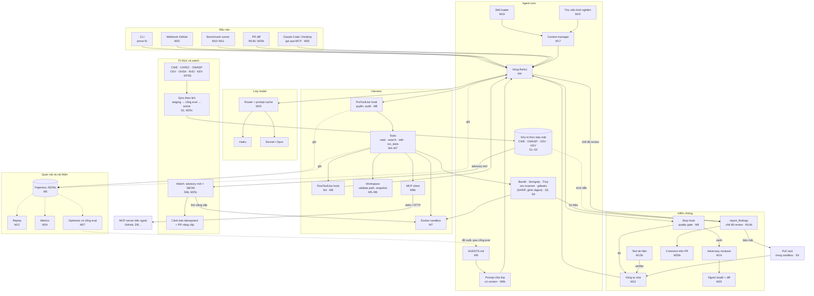

# Prova — Security coding agent xây từ số 0

> **Prova** (tiếng Ý / Bồ Đào Nha: *bằng chứng, phép thử*). Nguyên tắc của sản phẩm: **không có bằng chứng thì không báo lỗ hổng**
> (*"No proof, no finding."*).
>
> Tài liệu tham khảo nằm ngoài repo này: code sách ở `~/atlas-agents/` (các tham chiếu `chNN`, `shared/` trong plan
> đều chỉ tới đó); ghi chú sách và tài liệu testing / CWE ở `~/atlas-agents/OtherConcepts/`.

> Một **security coding agent** tự viết bằng Anthropic SDK thuần (không framework): **tìm → chứng minh bằng PoC trong
> sandbox → sửa** lỗ hổng, trên nền một coding agent chạy hai chế độ (**sửa bug** và **review PR**). Dùng cho **bất kỳ repo Python nào**. Kèm benchmark cho
> cả ba, dựng từ bug thật: bộ dev từ repo `atlas-agents`, bộ heldout từ CVE thật trong các project khác. Mục tiêu: hiểu sâu từng lớp của một agent production, và có số liệu thật để chứng minh.

Đây là **plan tổng**. Chi tiết của từng milestone (thiết kế, các bước, kiểm chứng, bẫy, câu hỏi cho LEARNINGS) nằm
trong file của từng Act, liệt kê ở [Bản đồ các Act](#bản-đồ-các-act).

---

## Mạch truyện

Bạn vừa đọc xong *Building AI Agents* và tìm ra hơn 40 bug trong repo đi kèm (`atlas-agents`): regex bỏ lọt jailbreak,
reviewer fail-open, sandbox không bao giờ bị tắt… Một nửa trong số đó là **lỗ hổng bảo mật**, và chưa chắc công cụ quét
nào báo ra chúng. Bạn tự hỏi: có thể xây một agent **tìm, chứng minh và sửa** loại lỗi này trên **bất kỳ repo Python
nào** không, và mỗi lần nó nói "đây là lỗ hổng" thì đều kèm bằng chứng chạy được? Đó là **Prova**. Những bug bạn vừa
tìm được trở thành bài kiểm tra đầu tiên của nó; CVE thật trong các project khác là bài thi cuối.

Ban đầu nó chỉ biết nói chuyện. Rồi nó học đọc code, học sửa code mà không phá máy bạn, học tự kiểm tra, học soát bug
trong PR trước khi bị merge, **học tìm và chứng minh lỗ hổng bảo mật bằng bằng chứng chạy được**, học làm việc dài hơi, học tự vệ trước bẫy, học chạy liên tục, và cuối cùng học tự cải
thiện. Mỗi Act mở đầu bằng **một vấn đề cụ thể** mà phiên bản hiện tại chưa giải được, và vấn đề đó chính là lý do
bước tiếp theo tồn tại.

### Định vị: security coding agent

Coding agent tổng quát thì đã nhiều. Điểm khác biệt của Prova là **mỗi finding bảo mật đều có bằng chứng**: một PoC
test chạy trong sandbox, trích dẫn từ nguồn chuẩn (CWE, OWASP), và số liệu so với công cụ chuẩn (Bandit, Semgrep) cùng
Claude Code. Phạm vi **chỉ phòng thủ**, trên code của bạn. Harness vẫn là harness chung (Act I–IV); bảo mật là lớp chuyên
môn đặt lên trên ([Act V](plans/act-5-security-agent.md)). Bảo mật **của chính agent** nằm ở [Act VII](plans/act-7-agent-security.md).

### Vì sao tự xây, khi đã có Claude Code?

Chính cuốn sách khuyên: nếu cần *dùng* một coding agent thì dùng Claude Code, Devin hay OpenHands, đừng tự xây (ch12).
Nhưng sách cũng nói: *"Build your own harness first. You can't evaluate the trade-off if you've never written the code
being traded"* (ch17). Prova là project **để học và để đo**, không phải để thay Claude Code. Vì vậy Claude Code luôn
có mặt trong benchmark làm mốc so sánh (M12b).

### Ba giai đoạn theo khung I-U-S của sách

| Giai đoạn | Nghĩa | Act |
|---|---|---|
| **I**mpressive | Demo chạy được | I–II |
| **U**seful | Chạy đúng cả với edge case, có số liệu | III–VII |
| **S**ustainable | Chạy liên tục, an toàn, tiết kiệm, tự cải thiện | VIII–IX |

Sách nhận xét đa số đội ngũ dừng ở chữ **I**. Mục tiêu của plan này là đi hết cả ba.

---

## Bản đồ các Act

| Act | File | Milestone | Câu hỏi của Act | Bàn giao |
|---|---|---|---|---|
| I — Nói chuyện với model | [act-1-api.md](plans/act-1-api.md) | M0a–M3 | API thật sự trả về cái gì? | repo nền, client, `extract()` có cấu trúc |
| II — Harness | [act-2-harness.md](plans/act-2-harness.md) | M4–M9b | Làm sao để agent làm việc mà không phá máy? | ReAct + tools + workspace + sandbox + hooks + MCP + hợp đồng + prompt có version |
| III — Đo lường | [act-3-measurement.md](plans/act-3-measurement.md) | M10–M12b | Nó giỏi đến đâu, và con số có đáng tin không? | benchmark 20+ task, baseline, so với Claude Code |
| IV — Tự sửa sai | [act-4-self-correct.md](plans/act-4-self-correct.md) | M13–M16 | Làm sao để nó tự kiểm tra và biết lúc dừng? | vòng tự sửa, test tái hiện, reviewer, review PR |
| **V — Security Agent** | [act-5-security-agent.md](plans/act-5-security-agent.md) | S1–S7 (+S6b) | Nó có tìm, **chứng minh** và sửa được lỗ hổng không? | kho tri thức bảo mật (RAG), PoC trong sandbox, vuln-bench so với Bandit/Semgrep/Claude Code · 🏁 **Điểm dừng 1** |
| VI — Trí nhớ và kỹ năng | [act-6-memory-skills.md](plans/act-6-memory-skills.md) | M17–M20 | Làm sao để không quên và không học lại từ đầu? | quản lý context, skill, kinh nghiệm, `/learn` |
| VII — Tự vệ (bảo mật của agent) | [act-7-agent-security.md](plans/act-7-agent-security.md) | M21–M22 | Nếu dữ liệu nó đọc chứa bẫy thì sao? | security-bench, phòng thủ đo được |
| VIII — Vận hành | [act-8-operations.md](plans/act-8-operations.md) | M23–M26 | Làm sao để nó chạy thật, liên tục? | router, service, worker, review PR tự động, MCP server |
| IX — Tự cải thiện và công bố | [act-9-self-improve.md](plans/act-9-self-improve.md) | M27–M29 | Làm sao để nó tự tốt hơn mà vẫn giải thích được? | vòng ratchet có cổng, bài viết |

**Tài liệu dùng chung:**
- [plans/shared/benchmark-spec.md](plans/shared/benchmark-spec.md): định dạng task, quy tắc test ẩn, kiểm chéo, metric, thống kê, cổng chất lượng, bảo vệ bộ eval.
- [plans/shared/anti-patterns.md](plans/shared/anti-patterns.md): 14 anti-pattern, cách phát hiện khi review.
- [plans/shared/code-conventions.md](plans/shared/code-conventions.md): quy ước code, mẫu registry, cây lỗi, `pyproject.toml`.
- [plans/shared/bug-sources.md](plans/shared/bug-sources.md): nguồn task cho benchmark (fix, review, security, **vuln**), có cột trạng thái.

---

## Mục lục milestone

**Ký hiệu:** ★ = đường chính · ○ = tùy chọn

| ID | Milestone | | Act | Phụ thuộc |
|---|---|---|---|---|
| M0a | Nền móng repo (config, lỗi, registry, composition root) | ★ | I | |
| M0 | Một lần gọi API | ★ | I | M0a |
| M1 | Hội thoại nhiều lượt và streaming | ★ | I | M0 |
| M2 | Tool đầu tiên, viết tay | ★ | I | M0 |
| M3 | Output có cấu trúc | ★ | I | M2 |
| M4 | Vòng ReAct chỉ đọc | ★ | II | M2, M3 |
| M5 | Workspace, phân quyền, trajectory log | ★ | II | M4 |
| M6 | Tool sửa code + rollback | ★ | II | M5 |
| M7 | Sandbox thay được backend | ★ | II | M5 |
| M8 | Hệ thống hooks | ★ | II | M5, M7 |
| M8b | MCP client | ★ | II | M8 |
| M9 | Hợp đồng hành vi `AGENTS.md` | ★ | II | M8 |
| M9b | Prompt là code | ★ | II | M9 |
| M10 | Benchmark v0 | ★ | III | M7 |
| M11 | Benchmark v1 | ★ | III | M10 |
| M12 | Record/replay + regression gate | ★ | III | M10 |
| M12b | Mốc so sánh: Claude Code headless | ★ | III | M11 |
| M13 | Vòng lặp kỹ thuật (grill → goal) | ★ | IV | M11 |
| M13b | Tái hiện trước, sửa sau | ★ | IV | M13 |
| M14 | Reviewer: tự kiểm hay đối kháng | ★ | IV | M13 |
| M14b | Chế độ review PR | ★ | IV | M14 |
| M15 | Best-of-N song song | ○ | IV | M13 |
| M16 | Thí nghiệm kiến trúc | ★ | IV | M13, M9b |
| S1 | Kho tri thức bảo mật: nguồn và đồng bộ | ★ | V | M5 |
| S2 | Chunking và truy hồi (bằng LlamaIndex) | ★ | V | S1 |
| S3 | Phát hiện (SAST + agent + trích dẫn) | ★ | V | S2, M14b |
| S4 | Chứng minh bằng PoC test | ★ | V | S3, M13b |
| S5 | Sửa và chống hồi quy | ★ | V | S4, M14 |
| S6 | Dependency và secret | ★ | V | S1 |
| S6b | Theo dõi lỗ hổng mới (watch) | ★ | V | S1, S6 |
| S7 | vuln-bench và so sánh với công cụ chuẩn | ★ | V | S5, S6, M11 |
| M17 | Quản lý context | ★ | VI | M13 |
| M18 | Skills với progressive disclosure | ★ | VI | M9b |
| M19 | Thư viện kinh nghiệm | ○ | VI | M13 |
| M20 | `/learn` có cổng duyệt | ★ | VI | M18 |
| M21 | Benchmark bảo mật và phòng thủ | ★ | VII | M11 |
| M22 | Giá của phòng thủ | ○ | VII | M21 |
| M23 | Định tuyến model và chi phí | ★ | VIII | M11 |
| M24 | Service + metric | ★ | VIII | M13 |
| M25 | Worker chạy liên tục | ★ | VIII | M24 |
| M25c | Sync và watch chạy liên tục | ★ | VIII | M25, S1, S6b |
| M25b | Review PR (cả bảo mật) tự động trên GitHub | ★ | VIII | M25, M14b, S4 |
| M26 | Prova là MCP server | ★ | VIII | M8b, M14b |
| M27 | Tối ưu có cổng eval | ★ | IX | M11, M25 |
| M27b | Tiến hóa code bằng OpenEvolve | ○ | IX | M27 |
| M28 | So với harness và framework (Agent SDK, Managed Agents) | ○ | IX | M11 |
| M29 | Viết lại hành trình | ★ | IX | tất cả |

---

## Quy tắc chung

1. **Claude viết code từng phần nhỏ, bạn đọc, chạy và giải thích lại được.** Claude không tự chạy; phần nào bạn muốn
   tự viết (nên là phần lõi như registry, vòng ReAct) thì nói trước. Tự viết lõi trước, so với framework sau (mục 🔁).
2. **Mỗi milestone nhỏ** (1–2 buổi), chạy được, có commit riêng.
3. **Mỗi milestone kết thúc bằng một mục trong `LEARNINGS.md`**: đã làm gì, gặp lỗi gì, học được gì (mỗi file Act có
   sẵn "📝 Câu hỏi cho LEARNINGS.md").
4. **Không dùng framework cho phần lõi.** Chỉ `anthropic` SDK, `pytest`, Docker.
5. **Từ Act III trở đi, mọi thay đổi phải đo** bằng benchmark (≥ 3 seed, trung bình ± SEM) trước khi giữ.
6. **Review mọi milestone bằng [checklist anti-pattern](plans/shared/anti-patterns.md)** và theo
   [quy ước code](plans/shared/code-conventions.md) (config, kiểu dữ liệu, registry, lỗi, test, tooling).
7. **Repo `prova` có `AGENTS.md` và `ROADMAP.md` ngay từ M0** (sách ch10): Implemented / In Progress / Backlog P0–P2 /
   **Decisions Log**. Mỗi buổi làm việc với Claude Code mở đầu bằng *"Đọc AGENTS.md và ROADMAP.md, cho biết việc đang dở
   và P0 tiếp theo"*; trước mỗi milestone dùng `/grill-me`.
8. **Quy tắc hồi quy** (sách ch10): mỗi bug tìm thấy trong chính harness thì viết test hoặc eval bắt được nó **trước**,
   xác nhận nó fail, rồi mới sửa, và commit cả hai cùng lúc.

## Nguyên tắc nền (rút ra từ sách)

1. **"The generator proposes, the verifier disposes."** Agent không thể tốt hơn bộ đo của nó. Verifier mới là nút thắt,
   không phải model (ch20, lời tựa).
2. **Chuyển luật từ prompt vào code.** Prompt có thể bị jailbreak, code Python thì không (ch15).
3. **Phần nào tất định thì viết code**, không dùng agent: runner, verifier, chấm điểm, định tuyến theo sự kiện (ch1).
4. **Bắt đầu đơn giản, chỉ thêm phức tạp khi có lý do cụ thể.** Thêm agent là trả "thuế điều phối" (ch4, ch6).
5. **Không bao giờ hỏng hai lần theo cùng một cách** (ch20).
6. **Dữ liệu không tin cậy không bao giờ vào system prompt.** Nó vào lượt user, bọc trong thẻ (ch14).
7. **Mọi sự tự sửa đổi đều được ghi lại, có version và qua cổng eval** (ch20, ch22).
8. **Mắt bạn là nút thắt** (Appendix B). Phần bắt buộc vẫn phải tự review: spec và goal, **thay đổi trong bộ eval**, các
   escalation, và mọi sự tự sửa đổi.

---

## Kiến trúc

### Hệ thống hoàn chỉnh (sau Act IX)

Mỗi khối ghi milestone tạo ra nó. Đọc từ trên xuống: việc đi vào từ đâu, agent suy nghĩ ra sao, hành động đi qua những
lớp kiểm soát nào, ai kiểm chứng kết quả, và dữ liệu được dùng lại thế nào.



Chi tiết phần bảo mật: sơ đồ Act V và **một tác vụ bảo mật từ đầu đến cuối** (sequence diagram) ở
[act-5-security-agent.md](plans/act-5-security-agent.md#kiến-trúc); ranh giới tin cậy ở
[act-7-agent-security.md](plans/act-7-agent-security.md#ranh-giới-tin-cậy).

### Kiến trúc lớn dần qua từng Act

| Act | Thành phần được thêm vào |
|---|---|
| I | Client gọi API, vòng tool viết tay, output có cấu trúc |
| II | Vòng ReAct, Workspace, các tool, Docker sandbox, hooks, **MCP client**, `AGENTS.md`, **prompt chia lớp có version**, trajectory log |
| III | Benchmark runner, test ẩn, record/replay, CI gate, baseline Claude Code |
| IV | Bước "grill" ra goal kiểm chứng được, vòng tự sửa, **test tái hiện**, reviewer đối kháng, **chế độ review PR + review-bench**, best-of-N, các kiến trúc thay thế |
| **V** | **Kho tri thức bảo mật (nguồn chuẩn, đồng bộ, chunk theo cấu trúc, hybrid search), công cụ chuẩn trong sandbox (Bandit, Semgrep, Trivy, osv-scanner, gitleaks; đọc SARIF; ghim digest), PoC test, sửa + adversary vượt rào, dependency/secret, **theo dõi lỗ hổng mới (watch)**, vuln-bench** |
| VI | Context manager (có vùng ghim), scratchpad, subagent, skill loader, thư viện kinh nghiệm, `/learn` |
| VII | Ranh giới tin cậy, scanner, chặn mạng, chặn SSRF, phòng thủ MCP (pin hash, namespace), lọc secret ở đầu ra, circuit breaker |
| VIII | Router model, sync + watch chạy liên tục, service API, worker, watchdog theo tiến độ, metrics, adapter GitHub/GitLab, **review PR tự động trên GitHub**, **Prova là MCP server** |
| IX | Optimizer có cổng eval (ratchet kiểu Karpathy, chọn ứng viên kiểu Pareto), ○ OpenEvolve |

### Bố cục code dự kiến của `prova`

```
prova/
├── prova/
│   ├── config.py   structured.py
│   ├── llm/        (client, usage, routing)
│   ├── agent/      (loop, goal, feedback)
│   ├── tools/      (base, fs, search, edit, run_tests)
│   ├── harness/    (workspace, permissions, trajectory, hooks, sandbox/)
│   ├── context/    (manager, notes, compaction)
│   ├── skills/     (loader)
│   ├── review/     (findings, review mode)
│   ├── security/   (kb/, sarif, sast, findings, poc, fix, deps, sbom, secrets, watch)  ← Act V
│   ├── mcp/        (client, server)
│   └── service/    (api, worker, watchdog)
├── prompts/  skills/  bench/  experiments/  tests/
├── AGENTS.md  contract.yaml  permissions.yaml  scaffold.yaml
└── ROADMAP.md  LEARNINGS.md  escalations.md
```

---

## Sau plan: Project 2 — Pentest agent

Hướng dùng CVE/CWE để xây agent pentest **không nằm trong plan này**, vì nó nặng và có yêu cầu an toàn riêng. Nên làm
**sau Điểm dừng 1**, khi harness, sandbox, ranh giới tin cậy, benchmark, kho tri thức bảo mật và PoC (Act V) đã có sẵn để dùng lại.

Điều kiện bắt buộc:
- **Chỉ chạy trong lab được phép**: các ứng dụng cố ý có lỗ hổng (ví dụ OWASP Juice Shop, DVWA) chạy local bằng Docker.
  Không bao giờ nhắm vào hệ thống không có giấy phép bằng văn bản.
- **Allowlist phạm vi cứng ở tầng harness**, không phải ở prompt: mạng của sandbox chỉ nhìn thấy lab.
- Mọi hành động được ghi trajectory và có thể review lại.

---

## Bảng phủ nguồn

### Repo `atlas-agents`

| Chương | Milestone | Chương | Milestone |
|---|---|---|---|
| ch01 | M0–M2, M4, M16 | ch12 | M7 |
| ch02 | M9b, M16, M27 | ch13 | ○ tool kiểm tra bằng ảnh cho task frontend |
| ch03 | M2, M4, M18 | ch14 | M3, M5, M21, M22, M25b |
| ch04 | M13, M17 | ch15 | M5–M8 |
| ch05 | M12, M14, M14b, M15, M25 | ch16 | M25 |
| ch06 | M14 | ch17 | M28 |
| ch07 | M23 | ch18 | M10–M12, M14b |
| ch08 | M8b, M21, M26 | ch19 | M24 |
| ch09 | M13b, S1, S6, M18, M20 | ch20 | M13, M13b, M19, M23, M27 |
| ch10 | M8, M9, M11, M12b, M14b, M16, M25b | ch21 | M5, M14, M14b, M20 |
| ch11 | S1, S2, M17, M19 | ch22 | M21, M25, M25b, M26 |
| | | ch23 | M16, M27 |

### Tài liệu trong `OtherConcepts/`

- `tong-hop-modern-python-testing.md`: M10, M11, M13b, M18, anti-pattern #11.
- `cve_link.md` (CWE-918, SSRF): S1, S4, M21, Project 2.
- `Building AI Agents Gulli Nawalgaria.pdf` (sách gốc của repo); ghi chú theo từng chương ở `ghi-chu-sach-gulli.md`.

| Phần của sách | Ý chính | Milestone |
|---|---|---|
| Lời tựa, I-U-S | Verifier quyết định; Impressive → Useful → Sustainable | Nguyên tắc nền, phần mở đầu |
| ch1 | Khi nào *không* dùng agent; Reflection | Nguyên tắc nền, M16 |
| ch2 | Prompt bốn lớp, few-shot, versioning, ngân sách thinking | M9b, M16 |
| ch3 | Functional skill, ToolResult, retry chỉ cho lỗi tạm thời | M4, M23 |
| ch4–ch6 | Bắt đầu đơn giản, thuế điều phối, debate | Nguyên tắc nền, M14 |
| ch7 | Chỗ model nhỏ vỡ trước; planner lớn + executor nhỏ | M16, M23 |
| ch8 | Intent Mandate (ủy quyền trước) | M16, M25 |
| ch9 | Clarification Gates, luật viết script, slopsquatting, định tuyến skill, auto-optimization | M7, M18, M27b |
| ch10 | AGENTS.md + ROADMAP.md, Định nghĩa "xong", eval viết trước, quy tắc hồi quy, sàn coverage, plan mode, phạm vi không chồng nhau | Quy tắc 7–8, M9, M10, M11, M15, M16 |
| ch11 | Scratchpad (Read-Refine-Repeat, resonance loop), hybrid search, AST chunking | M17, S2 |
| ch12 | Build vs use, scaffolding quan trọng hơn model, stream output | Phần mở đầu, M7, M10 |
| ch14 | OWASP Agentic Top 10, NHI, lỗi lan truyền, circuit breaker | M21 |
| ch15 | Luật vào code, verifier do harness chạy, lỗi allowlist `shell=True` | M7, M8, anti-pattern #13 |
| ch16–ch17 | Watchdog theo dõi tiến độ, networking limited | M7, M25 |
| ch18 | Metric hồi phục lỗi, red-team mỗi lần, multi-judge, Phoenix | M11, M12, M14b |
| ch19 | Ngân sách chi phí + idempotent là bắt buộc | M25 |
| ch20 | Goal kiểm chứng được, feedback có cấu trúc, `/grill-me`, tool synthesis | M0, M13, M27 |
| ch21 | Untrusted data trong system prompt (lỗi), giao diện tiến độ, eval từ khóa | anti-pattern #12, M24, M29 |
| ch22 | Ratchet Karpathy, ghim ràng buộc khi nén, 5 điều kiện tiên quyết, kill-switch thật | M17, M25, M27 |
| Appendix A–B | Bảo vệ bộ eval, escalation là backlog, vai trò fleet, chống chiều lòng | M11, M13, M14 |
| Phụ lục bài báo | GEPA (Pareto), SkillOpt (giới hạn sửa, vùng bảo vệ), AlphaEvolve/OpenEvolve, AReaL2.0 (chọn đòn bẩy, kiểm soát nguồn học) | M19, M20, M27, M27b |

---

## Ước lượng

- **Đường chính (★):** khoảng 61–79 buổi (mỗi buổi 2–3 giờ). Toàn bộ kể cả ○: khoảng 79–97 buổi.
- **Điểm dừng 1:** hết Act V (S7): security coding agent có số liệu so với công cụ chuẩn, đủ làm project CV.
- **Chi phí API:** Act I–II gần như bằng 0. Từ Act III, mỗi lần chạy benchmark tốn khoảng vài đến vài chục đô la. Dùng
  Haiku khi phát triển, Sonnet khi đo chính thức. Record/replay ở M12 giảm chi phí debug.

## Tiến độ

✅ xong · 🟡 đang làm · ⬜ chưa bắt đầu. Cập nhật 2026-11-26; chi tiết từng việc ở `ROADMAP.md`.

| Act | Trạng thái |
|---|---|
| [I — Nói chuyện với model](plans/act-1-api.md) | ✅ M0a–M3 (còn tick ô trong file Act) |
| [II — Harness](plans/act-2-harness.md) | ✅ M4–M9b (còn viết lại LEARNINGS của M5) |
| [III — Đo lường](plans/act-3-measurement.md) | 🟡 M10, M12 xong · M11 hoãn (backlog) · M12b chưa làm |
| [IV — Tự sửa sai](plans/act-4-self-correct.md) | 🟡 M13 xong (grill → goal gộp vào M13b; chạy tiếp từ state chờ Act VIII) · M13b đang làm · M14–M16 chưa làm |
| [V — Security Agent](plans/act-5-security-agent.md) | ⬜ |
| [VI — Trí nhớ và kỹ năng](plans/act-6-memory-skills.md) | ⬜ |
| [VII — Tự vệ](plans/act-7-agent-security.md) | ⬜ |
| [VIII — Vận hành](plans/act-8-operations.md) | ⬜ |
| [IX — Tự cải thiện và công bố](plans/act-9-self-improve.md) | ⬜ |
