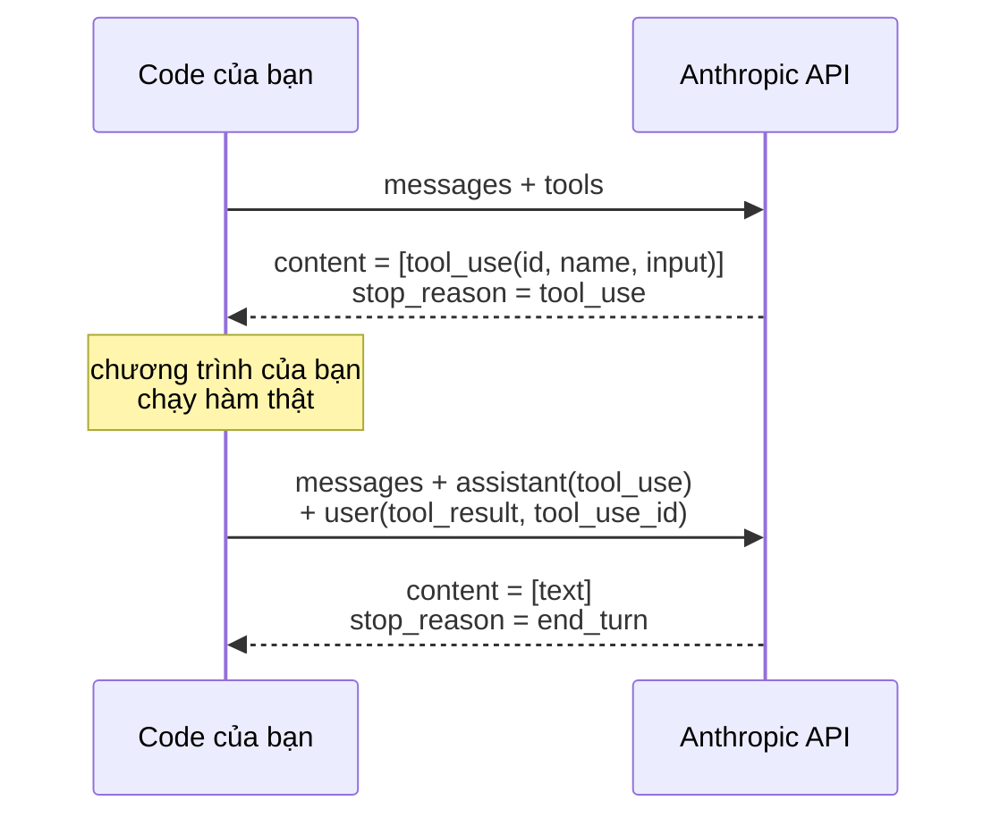

# Act I — Nói chuyện với model

[← Plan tổng](../PLAN.md) · [Act II →](act-2-harness.md)

> 📖 *"Trước khi xây agent, phải hiểu thật sự API trả về cái gì. Mọi thứ sau này đều xây trên đó."*
>
> Sách mở đầu bằng câu chuyện agent đầu tiên của tác giả: chạy vòng lặp vô hạn, đốt 4 đô trong 5 phút và in
> cùng một đoạn văn sáu lần. Bài học: *"an agent isn't a smarter chatbot. It is a loop. If you don't understand
> the loop, you can't constrain it."* Act I là để hiểu từng mảnh của vòng lặp đó trước khi ghép lại.

## Mục tiêu của Act

- Hiểu chính xác cấu trúc request/response của Messages API: content block, `stop_reason`, `usage`.
- Hiểu vì sao API **stateless** và hệ quả về chi phí.
- Tự tay viết vòng tool, và tự gây lỗi để hiểu luật của API.
- Lấy được output có cấu trúc **đáng tin cậy**, nền tảng cho mọi guardrail và verifier về sau.

## Bàn giao cuối Act

- Repo `prova` với nền móng theo [code-conventions.md](shared/code-conventions.md) (config, lỗi, registry, composition root),
  `AGENTS.md`, `ROADMAP.md`, `LEARNINGS.md`.
- Module `prova/llm/` (client có config, ghi usage) và `prova/structured.py` (hàm lấy output có cấu trúc).
- 4 script thí nghiệm trong `experiments/act1/` cùng kết quả đo.

## Luồng một lần gọi tool



---

## M0a ★ Nền móng repo

- 📖 *"Repo sách có `shared/config.py` dùng chung cho mọi chương: tiện, nhưng đọc env ngay lúc import, và registry ghi
  đè tool trùng tên mà không báo. Lần này dựng nền móng đúng một lần, để 29 milestone sau không phải sửa lại."*
- 🎯 **Mục tiêu học:** config bất biến, cây lỗi, registry dùng chung, composition root, test không cần `patch`.
  Mọi quy ước ở [code-conventions.md](shared/code-conventions.md).

### 📐 Thiết kế

```
prova/
├── src/prova/             # src layout (mặc định của `uv init --package`)
│   ├── __init__.py        # chỉ __version__, không side effect
│   ├── config.py          # Settings (Pydantic, frozen, SecretStr) + load_settings()
│   ├── errors.py          # ProvaError và cây lỗi
│   ├── registry.py        # Registry[T]: trùng tên báo lỗi, freeze, thứ tự ổn định
│   ├── app.py             # App + build_app(settings, *, llm=None): composition root
│   └── llm/
│       └── client.py      # LLMClient (Protocol) + make_client(settings)
├── tests/
│   ├── conftest.py        # chặn mạng; fixture settings từ dict giả
│   ├── fakes.py           # FakeLLM
│   └── unit/{test_config,test_registry,test_app}.py
├── experiments/act1/
├── AGENTS.md  ROADMAP.md  LEARNINGS.md  CLAUDE.md  .gitignore  .env.example  pyproject.toml
└── .claude/commands/grill-me.md
```

Phác thảo `Settings`, `Registry[T]`, cây lỗi, `build_app` và `pyproject.toml`: xem
[code-conventions.md](shared/code-conventions.md) mục 1, 3, 4, 5, 9.

### 🪜 Các bước

1. Môi trường bằng `uv` (mục 9 của quy ước), **chỉ cài thứ M0a dùng**:
   ```bash
   uv init --package --python 3.12          # tạo pyproject.toml, src layout, .python-version
   uv add anthropic pydantic python-dotenv
   uv add --dev pytest ruff pyright
   ```
   Thêm phần `[tool.ruff]`, `[tool.pyright]`, `[tool.pytest.ini_options]` vào `pyproject.toml`. Commit cả `uv.lock`.
   `.env` đã có sẵn (chỉ `ANTHROPIC_API_KEY`, đã ignore). `.env.example` chỉ có tên biến:
   `ANTHROPIC_API_KEY=`, `# PROVA_MODEL=claude-sonnet-5-5`.
2. `errors.py`: cây lỗi. Đây là file đầu tiên vì mọi file sau đều dùng nó.
3. `config.py`: `load_settings(env_file, *, environ, **overrides)`; đọc `.env` bằng `dotenv_values`, không `load_dotenv`.
4. `registry.py`: `Registry[T]`. Viết test **trước**: trùng tên, tên không hợp lệ, đăng ký sau khi freeze, `get` tên lạ,
   thứ tự lặp theo tên.
5. `llm/client.py`: `LLMClient` là Protocol chỉ gồm những method mình dùng (`messages.create`, sau này thêm `stream`,
   `count_tokens`); `make_client(settings)` tạo `anthropic.Anthropic(api_key=…, timeout=…)` **trong hàm**.
6. `app.py`: `build_app` lắp mọi thứ và freeze registry. Lúc này `App` mới chỉ có `settings` và `llm`; mỗi Act thêm trường.
7. `tests/conftest.py`: chặn socket cho mọi test không có marker `live`; `tests/fakes.py`: `FakeLLM` trả chuỗi response định sẵn.
8. `AGENTS.md` cho **chính repo** (mục tiêu, lệnh test, quy ước, những gì không được làm; trỏ tới code-conventions.md);
   `ROADMAP.md`: Implemented / In Progress / Backlog (P0–P2) / **Decisions Log**, ghi quyết định đầu tiên:
   *"Không dùng framework cho phần lõi, vì mục tiêu là hiểu từng lớp"*; `LEARNINGS.md` rỗng.
9. `.claude/commands/grill-me.md` theo mẫu sách ch20:
   ```markdown
   Interrogate our task description before doing anything: $ARGUMENTS
   Ask the hardest questions you can about scope, environment, verification, budget, rollback,
   and what "done" means — one round, numbered. Do not start work. When we've answered, restate
   the task as a goal with a machine-checkable termination condition.
   ```
10. `ruff check .`, `pyright`, `pytest` đều xanh → commit đầu tiên.

### 🧪 Kiểm chứng

| Test | Kỳ vọng |
|---|---|
| `python -c "import prova, prova.app"` khi **không có** `.env` và không có key | không lỗi (không đọc env lúc import) |
| `load_settings(environ={})` | `ConfigError` nhắc đúng `ANTHROPIC_API_KEY` và cách sửa |
| `.env` ghi `PROVA_MODEL=a`, `environ` ghi `PROVA_MODEL=b`, override `model="c"` | `c`; bỏ override thì `b`; bỏ cả environ thì `a` |
| `repr(settings)` và `str(settings)` | không chứa key |
| Sau `load_settings`, `os.environ` | không đổi |
| `PROVA_MAX_TOKENS=-1` hoặc biến lạ `PROVA_MODLE=…` | `ConfigError` (bắt lỗi gõ sai tên biến) |
| Registry: trùng tên / sau freeze / tên lạ / tên sai định dạng | đúng loại exception, thông báo có `kind` và tên |
| `build_app(settings, llm=FakeLLM(...))` | không gọi mạng; registry đã freeze |
| Một test cố gọi mạng mà không có marker `live` | fail ngay |

### ⚠️ Bẫy thường gặp

- `load_dotenv()` làm test rò rỉ sang nhau vì sửa `os.environ` toàn cục.
- `Settings` mutable rồi có chỗ sửa giữa chừng, hành vi khác nhau tùy thứ tự gọi.
- Registry dựa trên decorator lúc import: chạy riêng một test thì xanh, chạy cả bộ thì đỏ (hoặc ngược lại).
- `extra="forbid"` cho `Settings` cần cẩn thận: chỉ áp cho biến có tiền tố `PROVA_`, không áp cho cả `os.environ`.

### 🩹 Sửa lỗi của sách

`shared/config.py` đọc env và tạo biến global lúc import; `shared/skills.py` `SkillRegistry.register` ghi đè không báo
khi trùng tên, `execute_tool` trả lỗi dạng chuỗi. Xem bảng "Học từ `atlas-agents/shared/`" trong
[code-conventions.md](shared/code-conventions.md).

### 📚 Tham khảo

`~/atlas-agents/shared/config.py`, `shared/skills.py`; sách ch3 (Functional Skills), ch10 (AGENTS.md, ROADMAP.md), ch20 (`/grill-me`).

### ✅ Xong khi

Mọi dòng trong bảng kiểm chứng xanh; `uv run ruff check .`, `uv run pyright`, `uv run pytest` xanh; commit đầu tiên (gồm `uv.lock`).

### 📝 Câu hỏi cho LEARNINGS.md

- Vì sao `Protocol` dễ test hơn ABC? Viết một `FakeLLM` mất bao nhiêu dòng?
- Lỗi nào nên là exception, lỗi nào nên là dữ liệu (`ToolResult`)? Ranh giới nằm ở đâu?
- Vì sao thứ tự tool phải ổn định?

- [x] Hoàn thành (2026-11-22; mục tương ứng trong `LEARNINGS.md`)

---

## M0 ★ Một lần gọi API

- 📖 *"Mình đã gọi API hàng trăm lần qua code của sách, nhưng chưa bao giờ nhìn tận mắt nó trả về cái gì."*
- 🎯 **Mục tiêu học:** đọc được mọi trường của một response; biết các loại lỗi của SDK.

### 📐 Thiết kế

```
experiments/act1/m0_first_call.py    # settings = load_settings(); app = build_app(settings); app.llm.messages.create(...)
```

### 🪜 Các bước

1. `m0_first_call.py`: gọi một lần, in `response.model_dump_json(indent=2)`.
2. Thử từng biến thể và ghi lại `stop_reason`, `usage`:
   - `max_tokens=5` → `stop_reason = "max_tokens"`.
   - `stop_sequences=["3."]` với prompt "đếm từ 1 đến 10" → `stop_reason = "stop_sequence"`, xem trường `stop_sequence`.
   - Thêm `system=` → so `input_tokens` trước và sau.
3. Gọi `client.messages.count_tokens(...)` với cùng input, so với `usage.input_tokens`.
4. Cố ý gây lỗi và ghi lại **loại exception** của SDK: sai tên model, key sai, `max_tokens` âm, message rỗng.
   Đọc xem SDK có tự retry không và retry mấy lần. Quyết định lỗi nào sẽ được bọc thành `LLMError` ở tầng `llm/`.

### 🧪 Kiểm chứng

- Không có unit test nào gọi API thật; script thí nghiệm là `live`, chạy tay.
- Bảng "loại lỗi → exception → SDK có retry không" nằm trong `LEARNINGS.md`.

### ⚠️ Bẫy thường gặp

- Model mặc định cũ bị ngừng hỗ trợ (bạn đã gặp lỗi 404 với `claude-sonnet-4-20250514` ở ch01).
- `response.content[0].text` giả định block đầu luôn là text. Sai khi có thinking hoặc tool_use.

### 📚 Tham khảo

ch01 `online/atlas_v01_anthropic.py`; sách ch1 (agentic loop).

### ✅ Xong khi

Giải thích được từng trường của response mà không cần tài liệu; bảng lỗi nằm trong `LEARNINGS.md`.

### 📝 Câu hỏi cho LEARNINGS.md

- `stop_reason` có những giá trị nào, mỗi giá trị nghĩa là gì và code nên phản ứng ra sao?
- `count_tokens` và `usage.input_tokens` có khớp không? Vì sao?

- [x] Hoàn thành (2026-11-22; mục tương ứng trong `LEARNINGS.md`)

---

## M1 ★ Hội thoại nhiều lượt và streaming

- 📖 *"Vì sao lượt thứ 10 lại đắt hơn lượt thứ 1?"*
- 🎯 **Mục tiêu học:** cảm nhận bằng số liệu việc API stateless; hiểu streaming ở mức event.

### 📐 Thiết kế

```python
# prova/llm/usage.py
@dataclass
class UsageRecord:
    turn: int
    input_tokens: int
    output_tokens: int
    cache_creation_input_tokens: int = 0
    cache_read_input_tokens: int = 0
    latency_s: float = 0.0
    ttft_s: float | None = None     # time to first token (streaming)

class UsageLog:
    def add(self, rec: UsageRecord) -> None: ...
    def to_csv(self, path: Path) -> None: ...
```

### 🪜 Các bước

1. `m1_chat.py`: vòng chat terminal, giữ `messages` và append đủ cả lượt user lẫn assistant.
2. Sau mỗi lượt in `input_tokens`, `output_tokens`, tổng tích lũy; ghi CSV.
3. Chat 15 lượt, vẽ biểu đồ input token theo lượt và tổng tích lũy (matplotlib, lưu PNG).
4. Thêm chế độ `--stream`: dùng `client.messages.stream(...)`, lặp qua các event và in tên event:
   `message_start`, `content_block_start`, `content_block_delta`, `content_block_stop`, `message_delta`, `message_stop`.
5. Đo **TTFT** (từ lúc gửi đến `content_block_delta` đầu tiên) so với tổng thời gian.
6. Thử stream với một request có tool (dùng lại tool giả ở M2 khi tới đó) và xem `input_json_delta`.

### 🧪 Kiểm chứng

- Unit test `UsageLog` với dữ liệu giả.
- Kiểm tra bằng mắt: tổng input token tăng gần như tuyến tính theo lượt, nên tổng chi phí tăng bậc hai.

### ⚠️ Bẫy thường gặp

- Quên append lượt assistant: model "quên" câu trả lời trước.
- Hai lượt cùng vai liên tiếp: bản API ta thử ở M2 **chấp nhận** và gộp lại (cùng `input_tokens`, xem `LEARNINGS.md`
  mục M2, một lần chạy); vẫn nên giữ vai xen kẽ trong code để không phụ thuộc hành vi này.

### 🔬 Sâu hơn sách

Sách ch1 chỉ nói "always set a maximum". Ở đây bạn **đo** được vì sao: tổng token của một phiên N lượt xấp xỉ
tỉ lệ với N². Đây là động lực cho compaction ở M17 và caching ở M23.

### 📚 Tham khảo

ch01 `online/atlas_v01_streaming.py`; sách ch1, ch11 (context là tài nguyên hữu hạn).

### ✅ Xong khi

Có biểu đồ token theo lượt trong `LEARNINGS.md`, và giải thích được vì sao API stateless làm chi phí tăng nhanh.

### 📝 Câu hỏi cho LEARNINGS.md

- TTFT chiếm bao nhiêu % tổng thời gian? Streaming giúp gì cho người dùng, và **không** giúp gì?

- [x] Hoàn thành (2026-11-22; mục tương ứng trong `LEARNINGS.md`)

---

## M2 ★ Tool đầu tiên, viết tay

- 📖 *"Claude không chạy code của mình. Vậy cụ thể ai chạy, và kết quả quay về bằng đường nào?"*
- 🎯 **Mục tiêu học:** nắm luật của tool use bằng cách tự phá vỡ chúng.

### 📐 Thiết kế

```python
READ_FILE_TOOL = {
    "name": "read_file",
    "description": "Read a UTF-8 text file inside the workspace. Returns its content.",
    "input_schema": {
        "type": "object",
        "properties": {"path": {"type": "string", "description": "Path relative to workspace root"}},
        "required": ["path"],
    },
}

def run_tool_loop(client, task: str, max_iterations: int = 8) -> list[dict]:
    """Trả về toàn bộ messages để in trace."""
```

### 🪜 Các bước

1. Viết `read_file` đơn giản (chưa cần sandbox, chỉ đọc trong một thư mục thí nghiệm).
2. Vòng lặp: gọi API → nếu có block `tool_use` thì chạy → gửi `tool_result` cùng `tool_use_id` → lặp lại.
3. In trace dễ đọc: mỗi lượt in các block (`text`, `tool_use`, `tool_result`) và `stop_reason`.
4. Hỏi một câu cần đọc **hai** file để xem model có gọi nhiều tool trong một lượt không; nếu có, mọi
   `tool_result` phải nằm trong **một** message user.
5. **Tự phá luật**, ghi lại thông báo lỗi của API:
   - sai `tool_use_id`;
   - bỏ block `tool_use` khỏi lượt assistant trước khi gửi `tool_result`;
   - gửi `tool_result` mà không có `tool_use` tương ứng;
   - tách nhiều `tool_result` ra nhiều message.
6. Tool lỗi (file không tồn tại): trả `tool_result` với `is_error: true`, xem model phản ứng thế nào.
7. Gắn `max_iterations` và quan sát trường hợp hết lượt.

### 🧪 Kiểm chứng

Unit test cho phần dựng message (hàm thuần): cho một response giả có 2 `tool_use`, kiểm tra message trả lời có
đúng 2 `tool_result` với đúng id.

### ⚠️ Bẫy thường gặp

- Tên tool lệch giữa schema và dispatcher (`search_web` / `web_search` ở ch01).
- `calculator` dùng `ast.literal_eval` nên không tính được phép toán (ch01). Lỗi tool phải trả về dạng chữ cho
  model, không làm crash chương trình.

### 📚 Tham khảo

ch01 `online/atlas_v01_anthropic.py`; ch03 `atlas_v03.py`, `shared/skills.py`; sách ch1 (vòng tool 30 dòng), ch3.

### ✅ Xong khi

Giải thích được từng lỗi ở bước 5 và vì sao API bắt buộc như vậy.

### 📝 Câu hỏi cho LEARNINGS.md

- Vì sao API bắt giữ nguyên block `tool_use` trong lịch sử?
- Khi `is_error: true`, model làm gì khác so với khi tool trả chuỗi "Error: …" bình thường?

- [x] Hoàn thành (2026-11-22; mục tương ứng trong `LEARNINGS.md`)

---

## M3 ★ Output có cấu trúc

- 📖 *"Guardrail ở ch14 cho jailbreak lọt qua chỉ vì Haiku bọc JSON trong markdown. Và mẹo sửa mà sách dạy (tool giả +
  ép `tool_choice`) giờ bị API trả lỗi 400 trên model mới. Phải biết cả ba cách, và đo."*
- 🎯 **Mục tiêu học:** lấy dữ liệu có cấu trúc đáng tin cậy; hiểu vì sao API đổi cách làm; **đo** được độ tin cậy.

### Ba cách, và vì sao sách đã lỗi thời

| Cách | Cơ chế | Trạng thái (11/2026, kiểm tra lại tài liệu khi làm) |
|---|---|---|
| A. Prompt "chỉ trả JSON" + `json.loads` | hy vọng model nghe lời | cách của sách; hỏng khi model bọc markdown, thêm chữ, sai enum |
| B. Tool giả + `tool_choice` ép gọi + `enum` | model buộc phải gọi tool, schema có enum | **ch14 dùng cách này.** Từ Sonnet 5.5 / Opus 5.5, `tool_choice` loại `any`/`tool` trả **400**; chỉ còn chạy trên model cũ |
| C. **Structured outputs** | API ràng buộc output khớp JSON schema (constrained decoding) | **cách chuẩn hiện nay**: `client.messages.parse(..., output_format=Model)` hoặc `output_config.format`; với tool thì `strict: true` + `tool_choice: auto` |

`enum` vẫn giữ nguyên vai trò (giới hạn giá trị hợp lệ); thứ thay đổi là **cơ chế ép model tuân theo**.

### 📐 Thiết kế

```python
# prova/structured.py
class BugClassification(BaseModel):
    model_config = ConfigDict(extra="forbid")
    severity: Literal["critical", "major", "minor"]
    category: Literal["logic", "security", "resource_leak", "error_handling", "other"]
    confidence: float = Field(ge=0, le=1)
    reason: str

class StructuredError(ProvaError): ...

def extract[T: BaseModel](llm: LLMClient, schema: type[T], *, system: str, user: str, settings: Settings) -> T:
    """Dùng structured outputs; kiểm stop_reason (max_tokens, refusal) trước khi đọc;
    vẫn validate lại bằng Pydantic. Lỗi thì raise StructuredError — bên gọi quyết định fail-closed."""
```

Vẫn validate lại bằng Pydantic dù API đã ràng buộc: một số ràng buộc của schema (ví dụ `ge`/`le` của số) có thể không được
ép ở tầng decoding (kiểm tra tài liệu), và output có thể bị cắt khi `stop_reason = max_tokens`.

### 🪜 Các bước

1. `extract()` theo **cách C**. Kiểm `stop_reason` trước: `max_tokens` → `StructuredError("bị cắt")`; `refusal` → `StructuredError` kèm `stop_details`.
2. Viết **cách A** để so: prompt "Respond ONLY with JSON" rồi `json.loads`.
3. Thử **cách B** trên model hiện tại, **ghi lại lỗi 400** (loại exception, thông báo) vào `LEARNINGS.md`. Nếu tài khoản còn
   dùng được một model cũ chấp nhận ép `tool_choice`, chạy cách B trên đó để có đủ ba cột; không thì ghi "không chạy được".
4. Chuẩn bị 20 đoạn code có bug (lấy từ các bug đã biết trong repo sách).
5. Chạy **mỗi cách × 20 input × 3 seed**; ghi: lỗi parse, giá trị ngoài enum, thiếu trường, bị cắt.
6. Bọc mã nguồn trong thẻ `<code_to_classify>` ở lượt user (nguyên tắc 6).

### 🧪 Kiểm chứng

- Unit test `extract` với `FakeLLM`: `stop_reason = max_tokens` → `StructuredError`; `refusal` → `StructuredError`;
  JSON thiếu trường hoặc `confidence = 1.5` → `StructuredError`.
- Test bên gọi: khi `StructuredError` thì guardrail **chặn** (fail-closed).

### 📏 Đo

Bảng: cách A / B / C × (lỗi parse, ngoài enum, thiếu trường, bị cắt), trung bình ± SEM qua 3 seed.

### ⚠️ Bẫy thường gặp

- Lấy `response.content[0]` mà không lọc theo `type`.
- `max_tokens` quá nhỏ làm output bị cắt; structured outputs không cứu được chuyện này.
- Copy mẫu `tool_choice` ép buộc từ sách hoặc từ trí nhớ: lỗi 400 trên model mới.

### 🩹 Sửa lỗi của sách

Guardrail L2 (ch14) fail-open khi JSON hỏng; capstone dùng regex `\{[^{}]*\}`; scaffold_optimizer và judge
đều `json.loads` trên chữ tự do; mẹo ép `tool_choice` của ch14 không còn chạy trên model mới.

### 🔁 Đối chiếu framework

`client.messages.parse(output_format=Model)` chính là "framework nhỏ" của SDK cho việc này. Viết `extract()` mỏng quanh nó;
phần giá trị riêng là kiểm `stop_reason`, validate lại, và fail-closed.

### 📚 Tham khảo

ch14 `guardrailed_agent.py` (ví dụ ngược); sách ch3 (Pydantic structured outputs), ch14; tài liệu Anthropic về
structured outputs và strict tool use.

### ✅ Xong khi

Có bảng so sánh với số liệu thật, và `extract` được dùng lại ở mọi nơi cần output có cấu trúc từ đây trở đi.

### 📝 Câu hỏi cho LEARNINGS.md

- Cách xin JSON bằng prompt hỏng theo những kiểu nào? Kiểu nào nguy hiểm nhất cho guardrail?
- Vì sao API bỏ ép `tool_choice` mà vẫn giữ được output đúng schema?

- [x] Hoàn thành (2026-11-22; mục tương ứng trong `LEARNINGS.md`)

---

## Cuối Act I

- [x] Review toàn bộ code của Act bằng [checklist anti-pattern](shared/anti-patterns.md). (Kết quả trong `ROADMAP.md`, mục "Act I review".)
- [x] Cập nhật `ROADMAP.md` và Decisions Log.
- [x] `LEARNINGS.md` có mục cho M0–M3.

[Act II: Harness →](act-2-harness.md)
