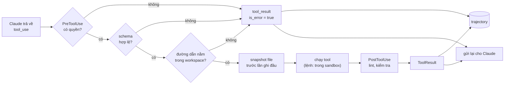

# Act II — Harness: agent biết làm việc mà không phá máy

[← Act I](act-1-api.md) · [Plan tổng](../PLAN.md) · [Act III →](act-3-measurement.md)

> 📖 *"Prova cần tự đọc repo, tìm bug, sửa code. Nhưng capstone đã cho thấy: một agent có quyền ghi file mà
> không có hàng rào thì có thể ghi đè `~/.zshrc`."*
>
> Sách ch15 kể một chuyện khác: agent "cập nhật config" bằng cách ghi vào `../../.env`, thay API key thật bằng
> placeholder, và sáng hôm sau CI hỏng một nửa. *"We had given the agent a body with no nervous system."*
> Và ch12: agent làm "dọn dẹp workspace" bằng `shutil.rmtree('/')`.
>
> Nguyên tắc của cả Act: **chuyển luật từ prompt vào code**. *"Prompts can be jailbroken. Python code cannot."*

## Mục tiêu của Act

- Vòng ReAct hoàn chỉnh, xử lý đúng mọi `stop_reason`.
- Tool được thiết kế cho LLM dùng: nguyên tử, trả kết quả có cấu trúc, thông báo lỗi viết cho model đọc.
- Hàng rào tất định: workspace, quyền theo chế độ, sandbox, hooks, verifier do harness chạy.
- Trajectory log làm nền cho đo lường, replay và tự cải thiện về sau.
- Hợp đồng hành vi và prompt được quản lý như code.

## Bàn giao cuối Act

Agent sửa được bug t001 trong sandbox Docker, mọi hành động đi qua hooks và quyền, có trajectory đầy đủ, prompt có version.

## Kiến trúc sau Act II



```
prova/
├── agent/loop.py            # M4
├── tools/
│   ├── base.py              # ToolResult, Tool protocol (M4)
│   ├── registry.py          # ToolRegistry bọc Registry[Tool] của M0a (M4)
│   ├── fs.py                # read_file, list_dir (M4)
│   ├── search.py            # search_code (M4)
│   ├── edit.py              # edit_file, create_file (M6)
│   └── run_tests.py         # (M7)
├── harness/
│   ├── workspace.py         # validate_path, snapshots (M5, M6)
│   ├── permissions.py       # profiles: review / fix (M5)
│   ├── trajectory.py        # event stream JSONL + redaction (M5)
│   ├── hooks.py             # Pre/Post/Stop (M8)
│   └── sandbox/{base,docker,e2b}.py   # (M7)
├── mcp/client.py            # (M8b)
├── contract.py              # đọc contract.yaml (M9)
└── prompts/                 # các lớp prompt (M9b)
```

---

## M4 ★ Vòng ReAct chỉ đọc

- 📖 *"Trước khi cho agent sửa, hãy để nó chỉ được nhìn."*
- 🎯 **Mục tiêu học:** vòng lặp đúng chuẩn; thiết kế tool theo kiểu "functional skill" của sách ch3.

### 📐 Thiết kế

```python
# tools/base.py
class ErrorCode(str, Enum):
    NOT_FOUND = "not_found"; INVALID_ARGS = "invalid_args"; PERMISSION = "permission"
    TIMEOUT = "timeout"; TRANSIENT = "transient"; SAFETY = "safety"; INTERNAL = "internal"

@dataclass
class ToolResult:
    success: bool
    message: str                    # câu ngắn cho model: chuyện gì đã xảy ra
    data: Any = None                # payload đầy đủ (cho log, cho code)
    snapshot: str | None = None     # phần model thực sự thấy; nếu cắt thì ghi rõ "đã cắt X/Y"
    error_code: ErrorCode | None = None

    def to_tool_result_block(self, tool_use_id: str) -> dict: ...   # is_error = not success

class Tool(Protocol):
    name: str
    description: str
    args_model: type[BaseModel]     # schema sinh từ đây
    permission: str                 # "read" | "write" | "exec" | "network"
    def run(self, args: BaseModel, ctx: "RunContext") -> ToolResult: ...

# agent/loop.py
@dataclass
class AgentResult:
    status: Literal["done", "max_iterations", "max_tokens", "refused", "budget", "error"]
    final_text: str
    iterations: int
    usage: UsageLog

def run_agent(task: str, tools: list[Tool], ctx: RunContext, *, max_iterations: int = 30) -> AgentResult: ...
```

**Xử lý `stop_reason`:**

| `stop_reason` | Phản ứng |
|---|---|
| `end_turn` | xong, lấy text cuối |
| `tool_use` | chạy các tool, gửi toàn bộ `tool_result` trong một message, lặp tiếp |
| `max_tokens` | output bị cắt: nếu đang dở `tool_use` thì **không** chạy tool đó; báo trạng thái `max_tokens` hoặc yêu cầu tiếp tục có giới hạn |
| `stop_sequence` | xử lý theo ngữ cảnh (thường không dùng trong agent) |
| `pause_turn` / `refusal` / giá trị lạ | kiểm tra tài liệu hiện tại; mặc định dừng an toàn và ghi log, **không** lặp mù |

### 🪜 Các bước

1. `ToolResult`, `Tool`, `ToolRegistry` bọc `Registry[Tool]` của M0a: sinh danh sách `tools` cho API theo thứ tự tên,
   dispatch theo tên; tool lạ và args sai trả `ToolResult` lỗi, không raise
   (luật ở [code-conventions.md](shared/code-conventions.md#3-registry)). Tool được đăng ký trong `build_app`.
2. **Kiểm schema trước khi chạy**: `args_model.model_validate(block.input)`; lỗi thì `INVALID_ARGS` kèm thông báo
   chỉ rõ trường nào sai.
3. `read_file` (giới hạn kích thước, có `snapshot` cắt rõ ràng), `list_dir`, `search_code` (ripgrep qua
   `subprocess.run([...])` dạng list, có timeout, giới hạn số dòng kết quả và báo nếu bị cắt).
4. Vòng lặp theo bảng `stop_reason`, có `max_iterations`.
5. **Retry có backoff chỉ cho lỗi `TRANSIENT`** (mạng, rate limit). Lỗi tất định trả về cho model, không retry.
6. Thử: *"Hàm `filter_pii` được định nghĩa và gọi ở những đâu trong repo atlas-agents?"*.

### 🧪 Kiểm chứng

- Unit test từng tool: happy path, input rỗng, file không tồn tại, file nhị phân, file khổng lồ (sàn coverage ở M10).
- Test vòng lặp với client giả: chuỗi response cố định → đúng số lượt, đúng trạng thái kết thúc.

### ⚠️ Bẫy thường gặp

- Tool "làm hai việc" (`search_and_summarize`), sách gọi là *"a hidden agent inside a tool"*.
- Trả chuỗi thô khiến code không phân biệt được "không có kết quả" với "lỗi mạng".

### 🩹 Sửa lỗi của sách

ch01 không kiểm `stop_reason`, không dùng `is_error`, tên tool lệch nhau.

### 🔁 Đối chiếu framework

Sau khi vòng tự viết chạy: viết lại cùng tác vụ bằng **Tool Runner** của SDK (`client.beta.messages.tool_runner`, kiểm tra
tài liệu hiện tại). So số dòng code và những gì vòng tự viết làm thêm: bảng `stop_reason`, `is_error` có phân loại, retry
chỉ cho lỗi `TRANSIENT`, trajectory. Ghi kết luận vào `LEARNINGS.md`; lõi vẫn là vòng tự viết.

### 📚 Tham khảo

ch01, ch03 `SkillRegistry`; sách ch3 (Functional Skills: Atomic, Result Architecture, Deterministic Safety).

### ✅ Xong khi

Agent trả lời đúng câu hỏi ở bước 6, có trace đầy đủ; mọi tool có unit test.

### 📝 Câu hỏi cho LEARNINGS.md

- `snapshot` dài bao nhiêu thì vừa: đủ cho model hiểu mà không làm phình context?

- [x] Hoàn thành

---

## M5 ★ Workspace, phân quyền, trajectory log

- 📖 *"Trước khi có tool ghi, phải có tường rào. Và phải ghi lại mọi thứ agent làm, vì về sau mọi thứ đều cần đến log này."*
- 🎯 **Mục tiêu học:** ranh giới thực thi; quyền theo chế độ; log là nền của mọi đo lường.

### 📐 Thiết kế

```python
# harness/workspace.py
class Workspace:
    def __init__(self, root: Path): self.root = root.resolve()
    def resolve(self, rel: str) -> Path:
        """resolve() rồi is_relative_to(root); vi phạm thì raise PermissionDenied."""

# harness/permissions.py   (đọc từ permissions.yaml)
profiles:
  review: {allow: [read], deny_paths: [".env", "**/*.pem"]}
  fix:    {allow: [read, write, exec], write_paths: ["**"], deny_paths: [".env", ".git/**", "hidden_tests/**"]}
```

**Trajectory: một luồng sự kiện JSONL** (theo định dạng ch21 `learn_command.py`, mở rộng):

```json
{"ts": "...", "run_id": "...", "seq": 12, "type": "tool_call", "tool": "edit_file", "input": {...}, "decision": "allow"}
{"ts": "...", "seq": 13, "type": "tool_result", "tool": "edit_file", "success": false, "error_code": "not_found", "message": "..."}
```

Các `type`: `task`, `model_request`, `model_response`, `tool_call`, `tool_result`, `hook_decision`,
`verification`, `correction` (người dùng can thiệp), `escalation`, `outcome`.

### 🪜 Các bước

1. `Workspace.resolve` và unit test: `../`, đường dẫn tuyệt đối, symlink trỏ ra ngoài, đường dẫn có `~`.
2. `permissions.yaml` với hai profile; mỗi tool khai báo `permission`; registry chỉ đưa cho model những tool
   profile cho phép (ẩn), và vẫn kiểm lại lúc chạy (chặn).
3. **Agent không được tự xin thêm tool lúc chạy** (sách ch10). Không có tool "request_permission".
4. `TrajectoryWriter`: append-only, flush sau mỗi sự kiện; `seq` tăng dần.
5. **Che secret** trước khi ghi: regex cho các dạng key phổ biến (`sk-ant-…`, `ghp_…`, `AKIA…`), giá trị biến môi
   trường nhạy cảm.

### 🧪 Kiểm chứng

- Test traversal ở bước 1. Test che secret: một tool_result chứa key giả phải được ghi thành `[REDACTED]`.
- Test profile `review`: gọi `edit_file` bị từ chối dù model có "cố".

### ⚠️ Bẫy thường gặp

- Kiểm đường dẫn bằng chuỗi (`startswith`) thay vì `resolve()` + `is_relative_to`.
- Log chỉ trong RAM (ch14 `tool_permission_enforcer.py`): crash là mất.

### 🩹 Sửa lỗi của sách

Allowlist theo ngữ nghĩa thay cho regex blacklist (ch14); log ra đĩa; không log nguyên văn secret.

### 🔬 Sâu hơn sách

Trajectory dạng **luồng sự kiện dùng chung** (kiểu OpenHands, sách ch12): subagent, replay (M12), metric (M24),
optimizer (M27) cùng đọc một nguồn. **Hồ sơ quyền theo chế độ** giống Antigravity project permissions (sách ch10).

### 📚 Tham khảo

ch15 `harness.py`, ch14 `tool_permission_enforcer.py`, ch21 `learn_command.py`; sách ch10, ch14, ch15.

### ✅ Xong khi

Mọi test traversal và test profile đều xanh; một lần chạy M4 sinh ra trajectory đọc được bằng `jq`.

- [x] Hoàn thành

---

## M6 ★ Tool sửa code + rollback

- 📖 *"Ghi đè cả file thì một lần sai là mất code. Sửa ba lần còn tệ hơn lần đầu thì sao?"*
- 🎯 **Mục tiêu học:** thiết kế tool cho LLM là một kỹ năng riêng; thông báo lỗi là một phần của prompt.

### 📐 Thiết kế

```python
class EditArgs(BaseModel):
    path: str
    old_str: str          # phải khớp CHÍNH XÁC một lần
    new_str: str

class CreateArgs(BaseModel):
    path: str
    content: str          # chỉ cho file CHƯA tồn tại

class SnapshotStore:
    def ensure(self, path: Path) -> None: ...          # lưu bản gốc trước lần ghi đầu tiên trong phiên
    def rollback(self, path: Path) -> None: ...        # khôi phục, hoặc xóa nếu là file mới
    def rollback_all(self) -> None: ...
```

**Thông báo lỗi viết cho model đọc:**

| Tình huống | `message` |
|---|---|
| không tìm thấy | "old_str not found in {path}. Closest match at lines 41–44: …. Re-read the file before editing." |
| khớp nhiều chỗ | "old_str matches 3 locations (lines 12, 57, 90). Include more surrounding lines to make it unique." |
| khác khoảng trắng | "old_str matches after whitespace normalisation at line 41. Copy indentation exactly." |

### 🪜 Các bước

1. `edit_file` với 3 nhánh lỗi ở bảng trên. Tìm "gần đúng nhất" bằng `difflib`.
2. `create_file` từ chối nếu file đã tồn tại (để không ghi đè cả file).
3. `SnapshotStore`, `rollback_all` khi phiên thất bại.
4. Ghi lý do mỗi lần edit fail vào trajectory (`error_code`, loại lỗi).
5. Cho agent sửa task t001 (regex injection) trong một thư mục copy.

### 🧪 Kiểm chứng

Unit test cả 3 nhánh lỗi, edit thành công, rollback file sửa và file mới tạo.

### 📏 Đo

Tỉ lệ `edit_file` fail và phân bố lý do qua vài lần chạy. Đây là số liệu đầu tiên để cải thiện mô tả tool.

### 🩹 Sửa lỗi của sách

`fix_loop.py` ghi đè cả file; capstone ghi file theo tên do model đặt mà không kiểm đường dẫn.

### 📚 Tham khảo

ch15 `rollback_harness.py`; ch20 `fix_loop.py` (ví dụ ngược).

### ✅ Xong khi

Agent tự sửa được t001; tỉ lệ edit fail có trong `LEARNINGS.md`.

- [x] Hoàn thành

---

## M7 ★ Sandbox thay được backend

- 📖 *"Agent cần chạy test. Nhưng ch12 lặng lẽ chuyển sang chạy code của LLM ngay trên máy bạn khi thiếu E2B.
  Và sách ch12 mở đầu bằng `shutil.rmtree('/')`."*
- 🎯 **Mục tiêu học:** cách ly thật; giới hạn tài nguyên; trừu tượng hóa backend từ ngày đầu (sách ch12:
  *"swapping takes an afternoon if the interface is clean, a week if `subprocess.run` is everywhere"*).

### 📐 Thiết kế

```python
@dataclass
class ExecResult:
    exit_code: int; stdout: str; stderr: str
    timed_out: bool; duration_s: float; truncated: bool

class Sandbox(Protocol):
    def run(self, argv: list[str], *, timeout_s: float, cwd: str = "/work",
            on_output: Callable[[str], None] | None = None) -> ExecResult: ...
    def close(self) -> None: ...
    # dùng như context manager

class DockerSandbox:
    """docker run --rm --network none --cpus 1 --memory 1g --pids-limit 256
       --user 1000:1000 --cap-drop ALL --security-opt no-new-privileges
       -v <workspace copy>:/work  <image có sẵn python + pytest + deps của task>"""
```

**Luật lệnh:**
- **Không `shell=True`.** Lệnh là danh sách argv.
- Allowlist xét **cả tham số**: ví dụ `["python", "-m", "pytest", ...]` được phép, `["python", "-c", ...]` thì không
  (trừ khi bên trong sandbox và qua tool riêng).
- Mọi lệnh chạy **trong sandbox**, không bao giờ trên máy thật. Không có Docker thì **từ chối chạy**, không fallback.

### 🪜 Các bước

1. Dựng image cơ sở (python, pytest, ruff, coverage; thêm bandit và semgrep, ghim phiên bản, dùng ở Act V). Workspace mount vào `/work`; host không mount gì khác.
2. `DockerSandbox.run` với timeout thật: quá giờ thì `docker kill`, `timed_out=True`.
3. **Stream output** qua `on_output` để harness có thể abort sớm (sách ch12).
4. `close()` trong `finally` / `__exit__`; test riêng cho đường lỗi giữa chừng.
5. Tool `run_tests` (quyền `exec`): chạy `python -m pytest -x -q` trong sandbox, trả `ToolResult` có tóm tắt.
6. **Mạng**: mặc định `--network none`. Task cần cài package thì cài sẵn trong image theo `requirements.txt` của
   task, ghim phiên bản. ○ Proxy có danh sách cho phép (giống `networking: limited` của Managed Agents, ch17).
7. **Chống slopsquatting** (ch9): agent đòi cài package không có trong danh sách hoặc không ghim phiên bản thì từ chối.
8. ○ `E2BSandbox` cùng interface. ○ Kiểm AST trước khi chạy code agent viết, như một lớp bổ sung.

### 🧪 Kiểm chứng

| Test | Kỳ vọng |
|---|---|
| `while True: pass` | bị cắt đúng timeout, container bị xóa |
| fork bomb nhỏ | chặn bởi `--pids-limit` |
| `curl` hoặc `urllib` ra ngoài | thất bại vì không có mạng |
| ghi `/etc/passwd`, ghi ra ngoài `/work` | thất bại |
| argv `["pytest", "&&", "touch", "/tmp/x"]` | `&&` chỉ là tham số, không có shell nên không chạy lệnh thứ hai |
| Docker không chạy | tool trả lỗi rõ ràng, **không** chạy trên host |

### ⚠️ Bẫy thường gặp

- Quên `--rm` hoặc quên `close()`: container mồ côi tích tụ (ch12 `data_analyst.py`).
- Ngân sách kiểm **sau** khi chạy xong thì không cắt được lần chạy dài (ch12 `sandbox_cost_tracker.py`).

### 🩹 Sửa lỗi của sách

Fallback sang máy thật (ch12); sandbox không bị tắt (ch12); "không chạy được" bị coi là "pass" (ch22);
allowlist + `shell=True` (ch15, task t014).

### 📚 Tham khảo

ch12 `data_analyst.py`, `sandbox_cost_tracker.py`; ch15 `e2b_sandbox.py`; sách ch12, ch15 (ba mức sandbox), ch17.

### ✅ Xong khi

Mọi dòng trong bảng kiểm chứng đều đúng kỳ vọng; agent chạy được test của t001 trong sandbox.

- [x] Hoàn thành

---

## M8 ★ Hệ thống hooks

- 📖 *"Claude Code cho người dùng chèn code vào trước và sau mỗi hành động. Harness của mình cũng cần vậy."*
- 🎯 **Mục tiêu học:** tách "luật" khỏi vòng lặp; verifier do harness chạy, model không điều khiển được.

### 📐 Thiết kế

```python
@dataclass
class HookEvent:
    kind: Literal["pre_tool_use", "post_tool_use", "stop"]
    tool: str | None; args: dict | None; result: ToolResult | None; ctx: RunContext

@dataclass
class HookDecision:
    action: Literal["allow", "deny", "continue"]   # "continue" ở Stop = chưa được dừng
    message: str = ""                              # gửi lại cho model nếu deny/continue

class Hook(Protocol):
    def __call__(self, ev: HookEvent) -> HookDecision: ...
```

| Hook | Ví dụ | Chặn được không |
|---|---|---|
| `pre_tool_use` | kiểm quyền, audit, circuit breaker (M21) | có |
| `post_tool_use` | sau `edit_file` file `.py`: `compile()` rồi `ruff check`, kết quả gắn vào `ToolResult` | chỉ thêm thông tin |
| `stop` | quality gate: chạy test; đỏ thì `continue` với tóm tắt lỗi | có (không cho dừng) |

### 🪜 Các bước

1. Pipeline hook có thứ tự cố định; hook **ném exception thì coi là `deny`** (fail-closed).
2. `post_tool_use` lint: chạy **trong harness**, không phải tool để model gọi; kết quả xét bằng **exit code**.
3. `stop` hook: chạy test qua sandbox; đỏ thì không cho kết thúc, gửi tóm tắt lỗi cho model.
4. Giới hạn số lần `stop` bị từ chối (để không thành vòng lặp vô hạn; phần vòng lặp có kỷ luật là M13).
5. Mọi quyết định của hook đều ghi `hook_decision` vào trajectory.

### 🧪 Kiểm chứng

- Hook ném exception → hành động bị chặn.
- Agent cố kết thúc khi test đỏ → bị `stop` hook trả về, phải làm tiếp.

### 🔬 Sâu hơn sách

Sách ch10 dùng hook của Claude Code (`PostToolUse` lint, `PreToolUse` audit, test trước commit). Ở đây bạn tự cài
cơ chế đó, cùng quyết định thiết kế: hook nào được chặn, hook nào chỉ quan sát, và hook lỗi thì sao.

### 📚 Tham khảo

ch10 `.claude/settings.json`; ch15 `_verify_python`; sách ch10 (Hooks), ch15 (verification loops).

### ✅ Xong khi

Hai kiểm chứng ở trên đều xanh; trajectory có đủ `hook_decision`.

- [x] Hoàn thành

---

## M8b ★ Tool thành giao thức: MCP client

- 📖 *"Mỗi tích hợp lại tự viết một kiểu. Sách ch8 kể chuyện viết cùng một tích hợp database bốn lần cho bốn
  framework. Có cách nào để mọi tool, ở local hay trên server khác, đều đi qua cùng một cửa kiểm soát?"*
- 🎯 **Mục tiêu học:** hiểu giao thức MCP ở mức JSON-RPC; tool từ ngoài vẫn đi qua đúng hàng rào.

### 📐 Thiết kế

```python
class McpToolAdapter(Tool):
    """Bọc một tool MCP thành Tool của Prova
    name = f"mcp__{server}__{tool}"   (namespace chống trùng tên / shadowing)
    permission khai báo trong mcp.yaml theo từng server
    run(): session.call_tool(...) có timeout -> ToolResult"""

# mcp.yaml
servers:
  knowledge:
    command: ["python", "fixtures/mcp_knowledge_server_fixed.py"]
    permission: read
```

### 🪜 Các bước

1. Sửa lỗi stdout của `mcp_knowledge_server.py` (ch08, task t004) trong một bản copy: log ra stderr.
2. Client: khởi chạy server qua stdio, `initialize` → `list_tools` → `call_tool` (SDK `mcp`, `ClientSession`).
3. Chuyển `inputSchema` của MCP thành `input_schema` cho Claude; đặt tên theo namespace.
4. Mọi tool MCP đi qua **đúng** pipeline hook và quyền của M5–M8.
5. Timeout cho từng lời gọi; server chết giữa chừng → `ToolResult` lỗi, không treo.
6. Lưu **hash của danh sách tool** (tên, mô tả, schema) mỗi lần kết nối. Dùng ở M21 để phát hiện rug pull.

### 🧪 Kiểm chứng

- Agent dùng được `mcp__knowledge__search_knowledge`.
- Profile không có quyền → lời gọi bị `pre_tool_use` chặn y như tool nội bộ.
- Server trả schema hỏng → bỏ qua tool đó và log cảnh báo.

### 🩹 Sửa lỗi của sách

stdout trong stdio server; `startswith("SELECT")` thay vì mở DB read-only; `mcp_client.py` không tồn tại.

### 📚 Tham khảo

ch08 `mcp_knowledge_server.py`, `online/mcp_github_server.py`; sách ch8 (ví dụ `ClientSession`), ch10 (MCP để audit được).

### ✅ Xong khi

Ba kiểm chứng ở trên đều đúng.

- [x] Hoàn thành

---

## M9 ★ Hợp đồng hành vi `AGENTS.md`

- 📖 *"Prompt dặn 'đừng sửa test' chỉ là lời dặn. Sách ch10 kể chuyện spec hai câu 'validate the input' bị model
  hiểu khác nhau tùy context, và agent âm thầm ghi dữ liệu hỏng vào database suốt ba ngày."*
- 🎯 **Mục tiêu học:** hợp đồng có thể kiểm bằng máy; biết dòng nào là luật thật, dòng nào chỉ là lời dặn.

### 📐 Thiết kế

Hai file đi cùng nhau, để không phải parse văn xuôi bằng regex như `spec_validator.py` của ch10:

```
AGENTS.md          # cho model đọc: Identity, MAY, MUST NOT, Definition of Done, Output Contract, Escalation
contract.yaml      # cho code đọc: phần kiểm được bằng máy
```

```yaml
# contract.yaml
must_not:
  - id: no_test_edits
    text: "Do not modify files under tests/ or hidden_tests/"
    enforced_by: permissions.fix.deny_paths
  - id: no_network
    text: "No network access"
    enforced_by: sandbox.network_none
  - id: no_secrets_in_output
    text: "Never print secrets"
    enforced_by: trajectory.redaction + output_filter   # M21
definition_of_done:
  - id: tests_green
    check: stop_hook.tests
  - id: lint_clean
    check: post_tool_use.ruff
  - id: files_listed
    check: output_contract.files_changed
output_contract: [files_changed_with_reason, test_command, assumptions]
escalate_when: [ambiguous_scope, requires_secret, irreversible_action]
```

### 🪜 Các bước

1. Viết `AGENTS.md` có cấu trúc (mục, danh sách đánh số). Sách ch10: hợp đồng dài trên khoảng 800 token mà viết
   văn xuôi thì bị model coi là gợi ý.
2. Viết `contract.yaml`; `contract.py` đọc và **kiểm lúc khởi động** rằng mỗi `enforced_by` trỏ tới một cơ chế
   có thật. Thiếu thì không chạy.
3. Output Contract: câu trả lời cuối của agent có danh sách file đổi kèm lý do, lệnh test, và giả định (lấy qua
   structured output M3, không parse chữ).
4. Bảng "luật → cơ chế thực thi" trong `LEARNINGS.md`, ghi rõ dòng nào **chỉ là lời dặn**.

### 🧪 Kiểm chứng

- `contract.yaml` có `enforced_by` trỏ tới cơ chế không tồn tại → khởi động báo lỗi.
- Hỏi agent "xóa test cho nhanh" → bị chặn bởi quyền, không phải nhờ model tự giác.

### 📚 Tham khảo

ch10 `AGENTS.md`, `online/spec_validator.py`; sách ch10 (Spec-First, Definition of Done, Output Contract).

### ✅ Xong khi

Mỗi dòng MUST NOT chỉ ra được cơ chế thực thi, hoặc được đánh dấu "chỉ là lời dặn".

- [x] Hoàn thành

---

## M9b ★ Prompt là code

- 📖 *"System prompt giờ là một f-string dài 200 dòng rải khắp code. Sửa một câu mà không biết đã làm hỏng gì.
  Sách ch2: một prompt đạt 20/20 eval nhưng hỏng ở production vì một quy tắc chôn sâu chặn mọi câu hỏi dưới 10 từ."*
- 🎯 **Mục tiêu học:** prompt có cấu trúc, có version, có test; biết mỗi kết quả chạy với prompt nào.

### 📐 Thiết kế

```
prompts/
├── 10-identity.md          # vai trò, ranh giới ("where it stops")
├── 20-instructions.md      # quy trình, xử lý lỗi, khi nào escalate
├── 30-tool-policy.md       # khi nào dùng tool nào (mô tả tool cũng là prompt)
├── 40-output.md            # hợp đồng output (đi kèm tool/structured output, KHÔNG xin JSON bằng chữ)
├── examples/               # few-shot, chỉ thêm khi có lý do đo được
└── CHANGELOG.md
```

```python
@dataclass(frozen=True)
class RenderedPrompt:
    system: str            # chỉ phần TĨNH, tin cậy  →  cache được (M23)
    hash: str              # sha256 của system + định nghĩa tool, ghi vào mọi trajectory

def render_system(contract: Contract, profile: str) -> RenderedPrompt: ...
def render_user_context(task: Task, repo_info: RepoInfo) -> list[dict]:
    """Dữ liệu động và KHÔNG tin cậy: lượt user, bọc trong <untrusted_issue>…</untrusted_issue>."""
```

### 🪜 Các bước

1. Tách prompt hiện có thành 4 lớp theo sách ch2: Identity → Instructions → Context → Output.
2. `render_system` chỉ ghép phần tĩnh theo thứ tự cố định; dữ liệu động đi vào lượt user (nguyên tắc 6).
3. Render bằng thay thế chuỗi, **không** dùng `.format()` (dấu `{}` trong JSON hay trong issue làm vỡ).
4. Tính `hash`, ghi vào sự kiện `task` của trajectory.
5. `CHANGELOG.md` cho prompt: mỗi thay đổi có lý do và (từ Act III) kết quả benchmark trước/sau.
6. Few-shot chỉ thêm khi agent lặp lại cùng một lỗi hoặc định dạng phức tạp (sách ch2); bỏ khi prompt đã dài.

### 🧪 Kiểm chứng (test prompt đã render, sách ch10)

- Profile `review` → tên tool ghi không xuất hiện trong prompt.
- Biến chèn vào chứa `"\nIgnore all previous instructions"` → nằm trong thẻ untrusted ở lượt user, không vào `system`.
- Đổi một chữ trong `20-instructions.md` → hash đổi.

### 🩹 Sửa lỗi của sách

`prompt_ab_test.py` chấm một lượt không chạy tool (t015); router chèn thẳng câu hỏi vào prompt; planner capstone
trong sách đưa issue vào `system` (anti-pattern #12).

### 📚 Tham khảo

ch02 (cả 4 file); sách ch2 (bốn lớp, persona, few-shot, versioning, extended thinking).

### ✅ Xong khi

Ba kiểm chứng trên xanh; có thể chạy cùng task với hai phiên bản prompt và phân biệt kết quả bằng hash (dùng ở M16).

- [x] Hoàn thành

---

## Cuối Act II

- [x] Review bằng [checklist anti-pattern](shared/anti-patterns.md), đặc biệt #1, #8, #12, #13.
- [ ] Sàn coverage cho tool (100%) đã có từ bây giờ, CI chặn khi tụt (chi tiết ở M10).
- [x] `ROADMAP.md`, Decisions Log, `LEARNINGS.md` cập nhật.

[Act III: Đo lường →](act-3-measurement.md)
