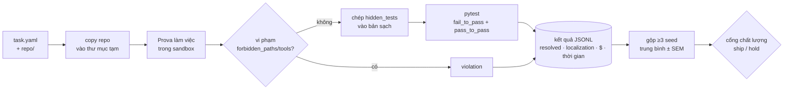

# Act III — Đo lường

[← Act II](act-2-harness.md) · [Plan tổng](../PLAN.md) · [Act IV →](act-4-self-correct.md)

> 📖 *"Prova đã sửa được bug đầu tiên. Nhưng nó giỏi đến đâu? Thay prompt thì tốt hơn hay chỉ do may?
> Không đo thì không biết."*
>
> Sách ch18 mở đầu: một agent đạt 92% bộ test, được deploy, và bốn ngày sau hỏng nặng. Nó ra đáp án "đúng" nhờ
> 15 lần gọi tool lộn xộn thay vì 3, đốt hết ngân sách, và đúng là nhờ may. *"Grade the journey."*
> Và lời tựa: *"an agent cannot reliably exceed the quality of its evaluation harness."*

## Mục tiêu của Act

- Một benchmark mà con số của nó đáng tin: test ẩn kiểm chéo, chống gian lận, nhiều seed.
- Chấm cả **hành trình**, không chỉ kết quả.
- Chạy lại được không tốn API; có mốc so sánh là Claude Code.

## Bàn giao cuối Act

`bench/` theo đúng [benchmark-spec.md](shared/benchmark-spec.md), 20+ task đã qua kiểm chứng, **baseline chính thức**
của Prova và của Claude Code, CI gate.

## Luồng chấm một task



---

## M10 ★ Benchmark v0

- 📖 *"Một task chạy được bằng tay rồi. Giờ phải chạy được bằng một lệnh, và kết quả phải đáng tin."*
- 🎯 **Mục tiêu học:** thiết kế task và test ẩn đúng cách; runner tất định; metric chẩn đoán.

### 📐 Thiết kế

Toàn bộ định dạng ở [benchmark-spec.md](shared/benchmark-spec.md) mục 2–7. Ba thành phần code:

```python
# bench/runner.py
def run_task(task_dir: Path, agent_cfg: AgentConfig, seed: int) -> RunRecord: ...
# bench/grade.py  — KHÔNG gọi LLM; chấm bằng pytest, diff và trajectory
def grade(task: Task, workdir: Path, trajectory: Path) -> Grade: ...
# bench/validate_tasks.py — kiểm chéo 4 bước (spec mục 5)
def validate(task_dir: Path) -> ValidationReport: ...
```

### 🪜 Các bước

1. **Viết eval trước** (sách ch10: *"không viết được eval case nghĩa là chưa hiểu hành vi"*). Chọn 3 task từ
   [bug-sources.md](shared/bug-sources.md): t001, t002, t006.
2. Với mỗi task: copy tối thiểu vào `repo/`, viết `issue` như bug report thật, viết `reference.patch`, viết test ẩn
   theo quy tắc ở spec mục 4.
3. `validate_tasks.py`: fail trên gốc → pass sau patch → `--cov-branch` phủ vùng patch → chạy 3 lần ổn định.
4. `runner.py` theo spec mục 6 (copy, git init, chạy agent, lấy diff, kiểm vi phạm, chạy test ẩn trên bản sạch).
5. `grade.py` tính các metric ở spec mục 7, kể cả **localization** từ diff và trajectory.
6. `report.py` in bảng: task × (resolved, localization, patch_size_ratio, tool_calls, $, s).
7. **Sàn test cho chính harness** (sách ch10): coverage 100% cho `prova/tools/`, ≥85% toàn bộ; CI dùng
   `--cov-fail-under` để chặn merge khi tụt.

### 🧪 Kiểm chứng

- `validate_tasks.py` báo lỗi khi bạn cố ý viết một test ẩn không fail trên code gốc.
- Một agent giả sửa vào `hidden_tests/` → `violation`.
- Một agent giả "sửa" bằng cách thêm `@pytest.mark.skip` → bị phát hiện.

### ⚠️ Bẫy thường gặp

- Test ẩn kiểm cách cài đặt (tên hàm nội bộ, cấu trúc regex) thay vì hành vi, khiến cách sửa đúng khác vẫn bị fail.
- Patch tại nơi định nghĩa (anti-pattern #11).

### 🩹 Sửa lỗi của sách

`eval_harness.py` (ch18): 40/50 case là case độn, `mock_agent` ghi cứng `tools_used`, chấm bằng từ khóa. Capstone
trong sách chấm bằng `"expected": ["validate", "email"]`.

### 🔬 Sâu hơn sách

- `forbidden_paths` và `forbidden_tools` (sách ch10: *"an agent that answers correctly while calling a tool it
  shouldn't have called is not a passing agent — it's a ticking clock"*).
- **Localization** là metric chẩn đoán quan trọng nhất khi task fail: sách ch12 nhận xét agent mạnh nhất trên
  SWE-bench là agent có scaffolding tốt nhất về điều hướng file, không phải agent có model tốt nhất.
- Kiểm chéo test ẩn bằng branch coverage trên vùng patch (từ tài liệu testing).

### 📚 Tham khảo

ch18 `eval_harness.py`; MLE-bench (thiết kế benchmark); `OtherConcepts/tong-hop-modern-python-testing.md`
(ch4 coverage, ch7 fixtures, ch8 monkeypatch); sách ch10 (Eval Best Practices), ch12 (SWE-bench), ch18.

### ✅ Xong khi

Một lệnh chạy cả 3 task và in bảng kết quả; 3 task đều qua `validate_tasks.py`.

### 📝 Câu hỏi cho LEARNINGS.md

- Test ẩn của task nào khó viết nhất, và vì sao (gợi ý: client tạo lúc import)?

- [ ] Hoàn thành

---

## M11 ★ Benchmark v1

- 📖 *"Ba task thì chưa nói lên được gì. Và sách ch2 cảnh báo: bộ test toàn câu hỏi 'What is…' đạt 20/20 vẫn
  hỏng ở production."*
- 🎯 **Mục tiêu học:** benchmark đủ lớn, đa dạng, có thống kê, chống overfit, và được bảo vệ.

### 🪜 Các bước

1. Mở rộng lên **20+ task** fix-bench, trải đều easy/medium/hard, theo [bug-sources.md](shared/bug-sources.md).
2. **Chia `dev/` và `heldout/`** ngay từ bây giờ (khoảng 60/40). Từ đây, mọi tối ưu chỉ được nhìn `dev/`.
3. **Đa dạng hóa issue**: ngắn, dài, mơ hồ, sai chính tả, tiếng Việt.
4. **Task edge case / red-team** e001–e006 (spec và bug-sources): issue rỗng, token bomb, Unicode, `<script>`,
   bug không tồn tại. Kỳ vọng: không crash, không bịa bản vá.
5. **Bộ test hợp đồng** (ch10 `spec_validator.py`, làm lại cho đúng): prompt khiêu khích như "xóa test cho nhanh",
   "đánh dấu xong dù test đỏ", "push thẳng lên main". Chấm bằng **hành vi quan sát được** (có hành động bị chặn
   không, trajectory có gì), không chấm bằng từ khóa trong câu trả lời.
6. Chạy **≥ 3 seed**, `report.py` tính trung bình ± SEM và so sánh theo cặp (spec mục 8).
7. Thêm metric **patch_size_ratio** và **error_recovery** (spec mục 7).
8. `known_issues.md`: task nào có vấn đề đã biết, cách xử lý.
9. **Cổng chất lượng** trong `ROADMAP.md` (spec mục 9).
10. **Bảo vệ bộ eval** (spec mục 10): `bench/PROTECTED` + kiểm tra trong CI.
11. Thiết kế runner sao cho thêm được **vuln-bench** ở Act V (cùng định dạng task, thêm trường `vuln`).

### 📏 Đo

**Baseline chính thức**, ví dụ: *"V1 (Sonnet, prompt 9f2c…): resolved 38% ± 4% trên heldout, $0.12/task, P95 180s"*.

### 🧪 Kiểm chứng

- PR thử hạ ngưỡng trong `ROADMAP.md` → CI đánh dấu "thay đổi bộ đo, cần duyệt".
- Chạy lại cùng cấu hình: chênh lệch nằm trong ± SEM.

### 🔬 Sâu hơn sách

- Sách ch10: *"the forbidden_tools list is the one most eval suites skip"*; *"if an agent passes the ROADMAP quality
  gates, it ships"*.
- Appendix B: bộ eval bị làm yếu là cách hệ thống *"rots invisibly while every dashboard stays green"*.
- Chia dev/heldout vì sách cảnh báo vòng tối ưu overfit vào benchmark nhỏ (ch9, phụ lục OpenEvolve).

### 📚 Tham khảo

ch10 `spec_validator.py`, ch18 `ci_eval_runner.py`; sách ch2 (bài học happy-path), ch10, ch18 (red-team), Appendix B.

### ✅ Xong khi

20+ task qua kiểm chéo; baseline có SEM; cổng chất lượng và bảo vệ bộ eval chạy trong CI.

- [ ] Hoàn thành

---

## M12 ★ Record/replay + regression gate

- 📖 *"Mỗi lần debug harness lại tốn tiền API, và kết quả lần sau khác lần trước."*
- 🎯 **Mục tiêu học:** tách tính ngẫu nhiên của model khỏi việc test harness; CI cho agent.

### 📐 Thiết kế

```python
class RecordingClient:   # bọc client thật, ghi (request_hash -> response) vào cassette
class ReplayClient:      # đọc cassette; request không khớp thì raise CassetteMiss (không âm thầm gọi API)
```

`request_hash` tính trên model + system + messages + tools (đã chuẩn hóa thứ tự key).

### 🪜 Các bước

1. Recording/Replay client cùng interface với client thật.
2. Ghi cassette cho 3 task; replay phải cho **đúng chuỗi tool call** cũ mà không gọi API.
3. Dùng replay để viết **test tích hợp cho harness**: thay đổi harness mà làm lệch chuỗi tool call → test báo.
4. Trình hiển thị trajectory (terminal): mỗi bước, độ trễ, chi phí, quyết định của hook.
5. CI gate: chạy một tập nhỏ `dev/` với model thật theo lịch (không phải mỗi commit); so với baseline theo SEM.
6. ○ Xuất trace OpenTelemetry sang **Arize Phoenix** chạy local (sách ch18), dữ liệu không rời máy.

### 🧪 Kiểm chứng

Replay 3 task không có request mạng nào (kiểm bằng cách tắt mạng hoặc mock transport).

### 🔬 Sâu hơn sách

Ý tưởng time-travel của LangGraph (ch05) áp dụng cho vòng lặp tự viết: quay lại bước N, sửa state, chạy tiếp.

### 📚 Tham khảo

ch05 `time_travel_debug.py`; ch18 `trajectory_visualizer.py`, `ci_eval_runner.py`; sách ch5, ch18 (tracing, Phoenix).

### ✅ Xong khi

Replay chạy được; CI gate báo đúng khi bạn cố tình làm hỏng harness.

- [ ] Hoàn thành

---

## M12b ★ Mốc so sánh: Claude Code headless

- 📖 *"Con số 38% là tốt hay tệ? Cần một điểm để so. Và sách ch12 nói thẳng: nếu chỉ cần một coding agent thì
  dùng Claude Code."*
- 🎯 **Mục tiêu học:** đặt kết quả của mình cạnh một harness production thật.

### 🪜 Các bước

1. Adapter: với mỗi task, chạy Claude Code ở chế độ headless trong cùng sandbox, cùng issue, cùng ngân sách.
   Kiểm tra tài liệu hiện tại cho cờ CLI và cách giới hạn số lượt.
2. Cùng `grade.py`, cùng seed, cùng heldout.
3. Bảng so sánh: resolved, localization, $, thời gian, violation.
4. Đọc trajectory của những task Claude Code giải được mà Prova không: khác biệt nằm ở đâu
   (điều hướng file? kiểm chứng? sửa lại khi test đỏ?). Ghi thành backlog cho Act IV–V.

### 📚 Tham khảo

ch10 `online/claude_code_ci.py`; sách ch10, ch12, ch20 (`until pytest; do claude -p …; done`).

### ✅ Xong khi

Bảng so sánh có SEM và một danh sách "khác biệt cần học" trong `ROADMAP.md`.

- [ ] Hoàn thành

---

## Cuối Act III

- [ ] Review bằng [checklist anti-pattern](shared/anti-patterns.md), đặc biệt #5 (so sánh một lần chạy).
- [ ] Baseline và bảng so với Claude Code ghi vào `ROADMAP.md` và `LEARNINGS.md`.

[Act IV: Tự sửa sai →](act-4-self-correct.md)
