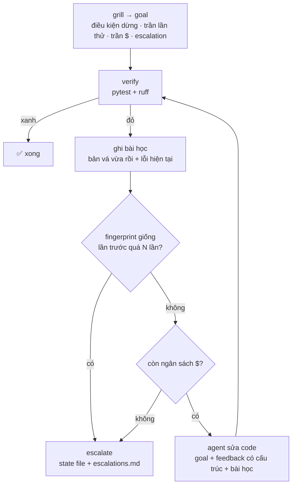
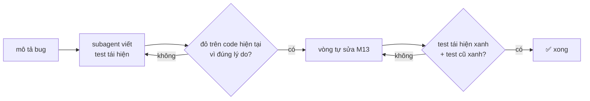

# Act IV — Tự sửa sai

[← Act III](act-3-measurement.md) · [Plan tổng](../PLAN.md) · [Act V →](act-5-security-agent.md)

> 📖 *"Baseline cho thấy agent sửa sai rồi dừng luôn, hoặc sửa đi sửa lại đúng một lỗi. Nó cần biết tự kiểm tra,
> rút kinh nghiệm, và biết lúc nào phải dừng để gọi người."*
>
> Sách ch20: một agent migration mất 9 phút mỗi lần thử; tác giả dán traceback vào 14 lần, xong lúc 2 giờ sáng.
> *"We were the trigger. We were the verifier. We were the memory. We were the escalation path."*
> Và: *"the verifier is the bottleneck, not the model."*

## Mục tiêu của Act

- Vòng tự sửa có kỷ luật: goal kiểm được bằng máy, feedback có cấu trúc, bài học nén, biết bỏ cuộc đúng lúc.
- Test tái hiện bug làm verifier.
- Reviewer thật sự đối kháng, và chế độ review PR có số liệu.
- Thí nghiệm kiến trúc có kết luận dựa trên dữ liệu.

## Bàn giao cuối Act

Agent sửa bug + reviewer PR trên cùng harness, benchmark cho cả hai, bảng so với Claude Code. Đây là nền để
[Act V](act-5-security-agent.md) biến Prova thành security coding agent.

## Vòng tự sửa

Bài học được ghi từ lỗi **sau** khi vá (khác với `fix_loop.py` trong repo):



---

## M13 ★ Vòng lặp kỹ thuật

- 📖 *"Mình đang là người dán traceback. Đã đến lúc tự sa thải khỏi việc đó."*
- 🎯 **Mục tiêu học:** năm thành phần của vòng lặp theo sách ch20: trigger, điều kiện dừng, feedback có cấu trúc,
  nén context, escalation.

### 📐 Thiết kế

```python
class Goal(BaseModel):                 # lấy bằng structured output (M3)
    statement: str
    termination_check: list[str]       # argv kiểm được bằng máy, ví dụ ["python","-m","pytest","-q"]
    max_attempts: int = 6
    max_usd: float = 1.0
    escalation: Literal["stop_and_report", "ask_human"]
    open_questions: list[str] = []     # câu hỏi không tự trả lời được → mơ hồ

@dataclass
class Lesson:
    attempt: int
    tried: str          # tóm tắt bản vá (từ diff, không phải lời model tự kể)
    failed_because: str # từ output verifier SAU khi vá
    fingerprint: str

def structured_feedback(pytest_output: str, history: list[Lesson]) -> str:
    """Vài dòng: test nào fail, lỗi gì ở đâu, lần nào fail giống thế, cách nào đừng lặp lại."""

def failure_fingerprint(pytest_output: str) -> str:
    """Hash của tập (test id, loại lỗi) đã sắp xếp — bỏ số dòng, đường dẫn tạm, thời gian."""
```

### 🪜 Các bước

1. **Bước grill → goal** (sách ch20 `/grill-me` và `/goal`): từ issue, agent soạn `Goal`. Phép thử của sách:
   *"một shell script có tự quyết định được điều kiện này không?"*. Không được thì viết lại goal. Ở chế độ tự
   động, `open_questions` không rỗng thì escalate thay vì đoán.
2. `failure_fingerprint` và `structured_feedback`: parse output pytest thành vài dòng (sách: *"don't feed the agent a
   raw 400-line error dump"*).
3. Vòng lặp theo sơ đồ; bài học lấy từ **diff thật** và **output verifier sau khi vá**.
4. Mỗi lượt, context được dựng lại từ goal + feedback + bài học, không kéo theo toàn bộ transcript cũ.
5. Escalation ghi state file (tiếp tục được) và một dòng vào `escalations.md`.
6. Chạy benchmark với và không có vòng lặp.

### 🧪 Kiểm chứng

- Unit test `failure_fingerprint`: cùng lỗi ở hai lần chạy khác thư mục tạm → cùng fingerprint.
- Unit test vòng lặp với agent giả luôn sinh cùng bản vá sai → escalate sau đúng N lần.

### 📏 Đo

Resolved trên heldout: baseline M11 so với M13 (so sánh theo cặp, ≥ 3 seed). Số lần thử trung bình đến khi xong.

### ⚠️ Bẫy thường gặp

- Fingerprint chứa số dòng hay đường dẫn tạm nên lần nào cũng "khác", và không bao giờ phát hiện giậm chân.
- Để model tự tóm tắt mình đã làm gì (có thể sai) thay vì tóm tắt từ diff.

### 🩹 Sửa lỗi của sách

`fix_loop.py` và `loop_harness.py` ghi bài học từ output **trước** khi vá (task t019; khung code trong sách ch20 làm
đúng); JSON bằng prompt; ghi đè cả file; capstone retry không nhận feedback.

### 🔬 Sâu hơn sách

**Escalation là backlog** (Appendix B): đọc `escalations.md` hằng tuần, mỗi mục là một cải tiến tiềm năng cho harness.

### 📚 Tham khảo

ch20 `fix_loop.py`, `online/loop_harness.py`; ch04 `online/escalation_chains.py`; sách ch20 (toàn chương), Appendix B.

### ✅ Xong khi

Mức tăng resolved đo được (hoặc không tăng, kèm phân tích vì sao).

- [ ] Hoàn thành

---

## M13b ★ Tái hiện trước, sửa sau

- 📖 *"Agent sửa bug dựa trên mô tả bằng chữ nên hay sửa nhầm chỗ. Kỹ sư giỏi thì viết một test làm bug lộ ra
  trước, rồi mới sửa."*
- 🎯 **Mục tiêu học:** test do LLM viết có thể sai; cách kiểm chứng một test.



### 📐 Thiết kế

```python
class ReproCheck(BaseModel):
    test_path: str
    fails_on_current: bool
    failure_kind: Literal["assertion", "exception_in_code", "import_error", "syntax_error", "collection_error", "passes"]
    valid: bool        # chỉ True khi fail ở assertion hoặc exception do code đang bị nghi
```

### 🪜 Các bước

1. Subagent (profile chỉ được ghi vào `tests/repro/`) viết test tái hiện từ issue.
2. Harness chạy test trên code hiện tại, phân loại `failure_kind`. `import_error`, `syntax_error`, `collection_error`
   là **tái hiện giả**.
3. Test hợp lệ được thêm vào `termination_check` của goal M13.
4. Kết thúc phiên: test tái hiện có thể giữ lại làm test hồi quy (tùy chọn của người dùng).

### 📏 Đo (dùng lại task của M11)

- **Tỉ lệ tái hiện**: test sinh ra đỏ trên code lỗi và xanh khi áp `reference.patch`.
- Mức tăng resolved so với M13.
- Branch coverage trên vùng code bị sửa; ○ điểm mutation (ví dụ `mutmut`) của test tái hiện.

### ⚠️ Bẫy thường gặp

Test tái hiện "đúng" nhưng kiểm cách cài đặt, khiến cách sửa đúng khác bị chặn. Áp quy tắc viết test ở
[benchmark-spec.md](shared/benchmark-spec.md) mục 4 cho cả test do agent viết.

### 📚 Tham khảo

ch20 `fix_loop.py`; ch09 `skills/test-generation`; `OtherConcepts/tong-hop-modern-python-testing.md` (ch3, ch4, ch8);
sách ch10 (Test Coverage, "use the agent to write the tests").

### 🔐 Nối sang Act V

Trong bảo mật, test tái hiện chính là **PoC test** chứng minh lỗ hổng (S4). Thiết kế `ReproCheck` ở đây để dùng lại được.

### ✅ Xong khi

Bảng "M13" so với "M13 + test tái hiện" có SEM.

- [ ] Hoàn thành

---

## M14 ★ Reviewer: tự kiểm hay đối kháng?

- 📖 *"Một agent tự chấm bài của mình thì có đáng tin không? Sách Appendix B: 'LLMs are trained to please you; an
  agent asked to review will find three minor nitpicks and approve.'"*
- 🎯 **Mục tiêu học:** reviewer chỉ có giá trị khi nó dám chặn; đo được giá trị đó.

### 📐 Thiết kế

```python
class Finding(BaseModel):
    severity: Literal["high", "medium", "low"]
    claim: str
    breaking_input: str          # input hoặc kịch bản cụ thể làm hỏng bản vá
class AdversaryVerdict(BaseModel):
    verdict: Literal["block", "pass"]
    findings: list[Finding]
    attacks_tried: list[str]     # "pass" mà không có attack nào là lỗi của adversary
```

### 🪜 Các bước

1. Tạo bộ "bản vá tệ" có chủ đích: sửa đúng test nhưng phá hành vi khác, hard-code giá trị test, nuốt exception.
2. Ba cấu hình: không reviewer / tự review (cùng agent) / adversary riêng với prompt **không cho điểm khi đồng ý**.
3. **Bộ phát hiện "đóng dấu cho qua"**: adversary không chặn lần nào trong N review gần nhất thì cảnh báo (ch21).
4. Khi builder và adversary **bất đồng**, đó là thứ đưa cho người xem (Appendix B: *"review the disagreements, not
   the output"*).
5. ○ Debate nhiều vòng (Generator/Challenger, sách ch6) cho task rủi ro cao.

### 📏 Đo

Tỉ lệ bắt bản vá tệ; tỉ lệ chặn nhầm bản vá tốt; **thuế điều phối**: chi phí và độ trễ thêm trên mỗi task (sách ch6).

### 📚 Tham khảo

ch05 `code_review_agent.py`; ch21 `online/adversarial_pair.py`; ch06 `online/hierarchical_crew.py`; sách ch6, Appendix B.

### ✅ Xong khi

Bảng 3 cấu hình × (bắt được, chặn nhầm, chi phí) có SEM, kèm quyết định có giữ adversary không.

- [ ] Hoàn thành

---

## M14b ★ Chế độ review PR

- 📖 *"Prova đã biết sửa bug. Liệu nó có nhận ra bug **trước khi** bug được merge?"*
- 🎯 **Mục tiêu học:** cùng harness, chế độ thứ hai; đánh đổi recall và precision.

### 📐 Thiết kế

```python
class ReviewFinding(BaseModel):
    file: str
    line: int
    severity: Literal["critical", "major", "minor"]
    category: Literal["logic", "security", "error_handling", "resource", "test", "other"]
    evidence: str               # trích dòng code / kết quả chạy chứng minh
    suggested_fix: str
    verified: bool = False      # đã chạy test trong sandbox để kiểm chứng
    cwe_id: str | None = None   # Act V (S3) dùng trường này
class ReviewReport(BaseModel):
    findings: list[ReviewFinding]
    summary: str
```

Profile `review`: chỉ đọc + chạy test trong sandbox. Diff và mô tả PR là **dữ liệu không tin cậy**, bọc trong thẻ.

### 🪜 Các bước

1. Input: diff; agent dùng tool chỉ đọc để tìm ngữ cảnh (chỗ gọi hàm, test liên quan).
2. Output qua `report_findings` (structured, M3).
3. Với finding mức `critical`/`major`: thử **kiểm chứng** bằng một test nhỏ trong sandbox; được thì `verified=True`.
4. **Review-bench**: PR có bug = **đảo ngược `reference.patch`** của task; PR sạch = `review/clean.patch`.
5. Judge chỉ dùng cho phần không kiểm được bằng test (finding có rõ ràng, có hành động được không): lý do **trước**
   điểm; **nhiều judge**; **hiệu chỉnh** với nhãn của bạn trên khoảng 30 mẫu (sách ch18: một judge tự đồng ý với
   chính nó chỉ khoảng 70% ở ca khó).

### 📏 Đo

Recall (đúng file, dòng lệch ±N), false positives / PR, tỉ lệ finding đã kiểm chứng, chi phí / PR.

### 🔬 Sâu hơn sách

Không có reviewer nào trong sách được đo bằng số liệu. Một reviewer báo 20 lỗi mỗi PR thì không ai đọc.

### 📚 Tham khảo

ch05 `code_review_agent.py`; ch10 `online/claude_code_ci.py`; ch21 `online/adversarial_pair.py`; sách ch18 (judge).

### ✅ Xong khi

Bảng recall / precision / chi phí; dùng được trên repo của chính bạn.

- [ ] Hoàn thành

---

## M14c → chuyển sang Act V

Review bảo mật dựa trên CWE đã được mở rộng thành cả một Act: kho tri thức (S1–S2), phát hiện (S3),
PoC (S4), sửa (S5). Xem [act-5-security-agent.md](act-5-security-agent.md).

---

## M15 ○ Best-of-N song song

- 📖 *"Một lần thử thì may rủi. N lần song song, để verifier chọn, có đáng tiền không?"*
- 🎯 **Mục tiêu học:** đánh đổi test-time compute; điều phối song song an toàn.

### 🪜 Các bước

1. Sinh N bản vá độc lập (mỗi nhánh một bản copy workspace, phạm vi không chồng nhau).
2. Verifier (test + adversary M14) chọn bản tốt nhất; hòa thì chọn diff nhỏ hơn.
3. **Chạy thử trên tập nhỏ để ước chi phí** trước khi chạy cả benchmark (bài học Dynamic Workflows, sách ch10).

### 📏 Đo

Đường cong pass@k theo chi phí, k = 1, 2, 4, 8.

### 📚 Tham khảo

ch05 `online/parallel_fanout.py`; sách ch10 (Dynamic Workflows), ch22 (multi-agent latency compounding).

- [ ] Hoàn thành

---

## M16 ★ Thí nghiệm kiến trúc

- 📖 *"Sách nói reasoning-first tốt hơn ReAct cho task phức tạp, Reflection giúp code tốt hơn, nghĩ nhiều quá lại có
  hại. Thật không, trên chính benchmark của mình?"*
- 🎯 **Mục tiêu học:** thiết kế thí nghiệm có kiểm soát; kết luận từ dữ liệu, không từ cảm giác.

### 🪜 Các bước

Mỗi biến thể là một cấu hình (một cờ trong `AgentConfig`), chạy trên `dev/` để chọn, báo cáo trên `heldout/`:

| Biến thể | Nguồn | Câu hỏi |
|---|---|---|
| ReAct (baseline) | ch1 | |
| Plan-and-execute | ch1 | lập kế hoạch trước có giúp task nhiều file không |
| Reasoning-first (một lần nghĩ lớn, thực thi tất định, **có đưa kết quả tool lại**) | ch22, ch23 | |
| Reflection (sinh → tự phê bình → sửa) | ch1 | sách khuyên nên có vài vòng cho code |
| Ngân sách extended thinking: 0 / 4k / 8k / 16k | ch2 | sách: code 5–8k; "nghĩ quá nhiều" có thể tệ hơn |
| Planner lớn + executor nhỏ | ch7, ch22 | rẻ hơn bao nhiêu, tụt bao nhiêu |
| Plan mode tự bật (>2 file hoặc tính năng mới) + cổng "tiếp tục?" | ch10 | |
| Mức tự chủ: giám sát / bán tự chủ / tự chủ hoàn toàn | ch10 | số lần cần người can thiệp |
| Tự chủ có ủy quyền trước (chính sách kiểu Intent Mandate) | ch8 | bao nhiêu % task tự merge được an toàn |
| ○ Code-as-action (agent viết Python thay vì gọi tool JSON) | ch5 smolagents | |
| ○ Model local qua Ollama | ch7 | cái gì vỡ trước: JSON, nhiều bước, hay vòng lặp |
| Ablation prompt: bỏ từng lớp của M9b | ch2 | câu nào trong prompt thật sự có tác dụng |

### 📏 Đo

Bảng: biến thể × (resolved, $, thời gian, can thiệp của người), ≥ 3 seed, so sánh theo cặp với baseline.

### 🩹 Sửa lỗi của sách

Reasoning-first trong `reasoning_vs_react_benchmark.py` chạy tool sau khi đã trả lời (task t020); judge mặc định 3.0
khi lỗi; `prompt_ab_test.py` chỉ chấm một lượt (t015).

### 📚 Tham khảo

ch01 `online/atlas_v01_plan_and_execute.py`; ch23 `online/reasoning_vs_react_benchmark.py`; ch10
`online/autonomy_benchmarker.py`; sách ch1, ch2, ch5, ch7, ch8, ch10, ch22.

### ✅ Xong khi

Bảng kết quả và **một đoạn kết luận dựa trên dữ liệu** cho mỗi câu hỏi, kể cả khi kết luận là "không khác biệt
đáng kể".

- [ ] Hoàn thành

---

## Cuối Act IV

- [ ] Review bằng [checklist anti-pattern](shared/anti-patterns.md).
- [ ] README tạm thời với bảng: Prova (các cấu hình) so với Claude Code, fix-bench và review-bench.

[Act V: Security Agent →](act-5-security-agent.md)
