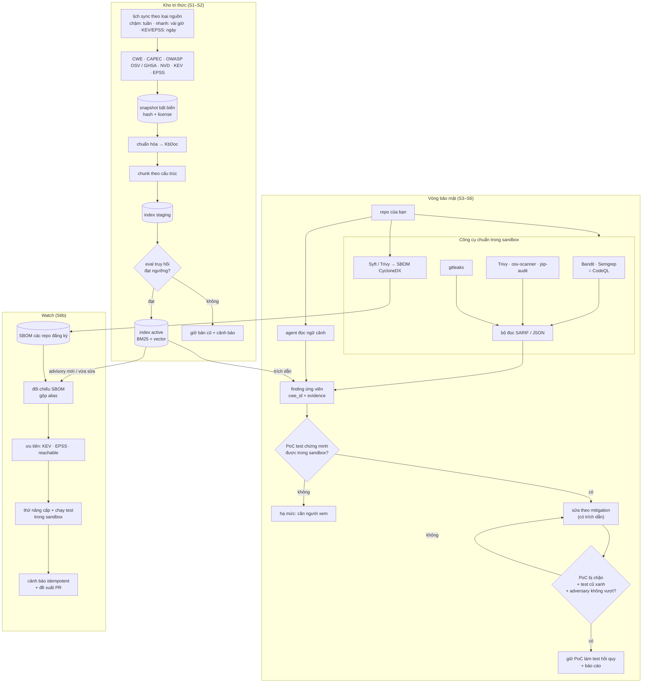
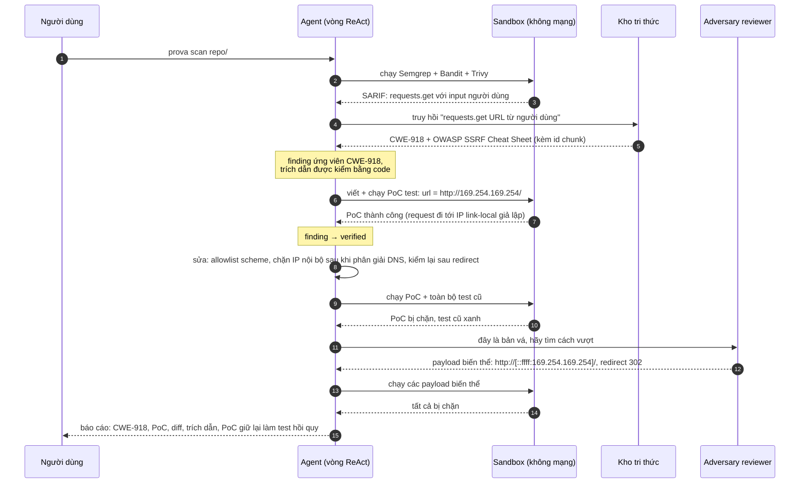

# Act V — Security Agent

[← Act IV](act-4-self-correct.md) · [Plan tổng](../PLAN.md) · [Act VI →](act-6-memory-skills.md)

> 📖 *"Coding agent tổng quát thì đã có rất nhiều. Còn một coding agent mà mỗi lần nó nói 'đây là lỗ hổng' đều
> kèm theo bằng chứng chạy được thì sao?"*
>
> Công cụ quét bảo mật theo luật báo nhầm rất nhiều, nên người dùng sớm bỏ qua cảnh báo. LLM reviewer thì "bịa" lỗ hổng
> nghe rất thuyết phục. Cả hai đều thiếu cùng một thứ: **bằng chứng**. Act này biến Prova thành một **security
> coding agent**: tìm → **chứng minh bằng PoC test trong sandbox** → sửa → chứng minh đã chặn được → giữ lại làm test hồi quy.
> Mọi khẳng định đều có trích dẫn từ nguồn chuẩn và có số liệu so với công cụ chuẩn.

## Hai nghĩa của "security" trong plan

| | Bảo mật **do** agent làm (Act này) | Bảo mật **của** agent ([Act VII](act-7-agent-security.md)) |
|---|---|---|
| Câu hỏi | Agent có tìm và sửa được lỗ hổng trong code của bạn không? | Agent có bị lừa, có phá máy không? |
| Vì sao liên quan nhau | Sản phẩm này **luôn đọc code đáng ngờ**, nên Act VII càng quan trọng | |

## Phạm vi (bắt buộc)

- **Chỉ phòng thủ, chỉ trên code của bạn hoặc code bạn được phép kiểm tra.**
- PoC test chạy **trong sandbox không mạng**, nhắm vào **hàm trong repo**, không nhắm vào hệ thống thật nào.
- Khai thác hệ thống đang chạy nằm ngoài Act này (xem Project 2 trong plan tổng, chỉ trong lab được phép).

## Mục tiêu của Act

- Một **kho tri thức bảo mật** từ nguồn chuẩn, đồng bộ định kỳ, có phiên bản, kiểm soát license và nguồn gốc.
- **Chunking và truy hồi** phù hợp từng loại nguồn, đo được chất lượng.
- Vòng **phát hiện → chứng minh → sửa → chứng minh lại**.
- Dependency và secret.
- **vuln-bench** và bảng so sánh với Bandit, Semgrep, Claude Code.

## Bàn giao cuối Act (🏁 Điểm dừng 1)

*"Security coding agent tự xây: tìm → chứng minh bằng PoC trong sandbox → sửa lỗ hổng; precision X%, recall Y% theo CWE,
so với Semgrep, Bandit và Claude Code."*

## Kiến trúc



```
prova/security/
├── kb/
│   ├── sources/{cwe,capec,owasp,osv,ghsa,nvd,kev,epss}.py
│   ├── snapshot.py   normalize.py   chunk.py   index.py   retrieve.py
│   └── eval.py                     # bộ đánh giá truy hồi
├── sarif.py                         # bộ đọc SARIF/JSON chung → SecurityFinding
├── tools.yaml                       # công cụ + phiên bản + digest đã ghim
├── sast.py                          # chạy Bandit/Semgrep (○ CodeQL) trong sandbox
├── findings.py                      # SecurityFinding, gộp tín hiệu, xếp ưu tiên
├── poc.py                           # sinh + chạy + phân loại PoC test
├── fix.py                           # sửa + kiểm lại + adversary vượt rào
├── deps.py   sbom.py   secrets.py      # Trivy/osv-scanner/pip-audit, Syft → CycloneDX, gitleaks
├── watch.py                         # S6b: advisory mới × SBOM → Alert
kb/ (dữ liệu, ngoài git hoặc git-lfs): snapshots/  index/  manifest.json  licenses.yaml
```

### Một tác vụ từ đầu đến cuối

Ví dụ: hàm `fetch_preview(url)` trong repo gọi `requests.get(url)` với URL do người dùng gửi.



---

## Công cụ chuẩn và vai trò

Các công cụ này **không thay thế agent**. Mỗi công cụ có hai vai trò: (1) **tín hiệu đầu vào**, giống Bandit ở S3; (2)
**baseline** để so trên vuln-bench. Giá trị riêng của agent là: chứng minh bằng PoC, xét mức thật sự dùng tới (reachability),
sửa kèm kiểm lại, và giải thích có trích dẫn.

| Nhóm | Công cụ | Dùng ở | Vai trò |
|---|---|---|---|
| SAST | Bandit, Semgrep | S3, S7 | tín hiệu + baseline bắt buộc |
| SAST sâu | ○ CodeQL | S7 | baseline thứ ba (miễn phí cho repo public; kiểm tra license khi dùng cho repo khác) |
| Dependency (SCA) | **Trivy**, osv-scanner, pip-audit | S6, S7 | tín hiệu + baseline cho phần dependency |
| SBOM | Syft, Trivy (xuất CycloneDX) | S6b | tạo SBOM chuẩn thay vì tự đặt format riêng |
| Cảnh báo dependency | Dependabot, Renovate | S6b | baseline cho **độ trễ phát hiện** và mức nhiễu |
| Secret | gitleaks, ○ trufflehog | S6 | tín hiệu + baseline |
| IaC / container | ○ Trivy (config, image), Checkov | mở rộng | quét Dockerfile của repo, và quét **chính image sandbox** của Prova |

### Quy tắc khi dùng

1. **Chạy trong sandbox**, đọc output dạng **SARIF** hoặc JSON. Viết **một** bộ đọc SARIF dùng chung cho Semgrep, Trivy,
   CodeQL, rồi chuẩn hóa về `SecurityFinding` (S3). Không parse output dạng text.
2. **Ghim phiên bản theo hash hoặc digest**: image theo `@sha256:…`, GitHub Action theo full commit SHA, binary kiểm checksum.
   Không dùng tag (`latest`, `v0.x`), vì tag có thể bị đẩy đè.
3. **Công cụ bảo mật cũng là chuỗi cung ứng.** Ví dụ thật: ngày 19/3/2026, `aquasecurity/trivy-action` bị đẩy đè 76/77 tag
   sang commit chứa mã đánh cắp credential, `setup-trivy` cũng bị, và có bản phát hành Trivy 0.69.4 độc hại
   (GHSA-69fq-xp46-6x23, CVE-2026-33634). Chỉ bản được bảo vệ bởi immutable release là không bị ảnh hưởng. Đây là lý do
   có quy tắc 2, và là một mục trong [Act VII](act-7-agent-security.md).
4. **Không cấp credential cho scanner.** Scanner chạy không mạng, dùng DB đã tải sẵn từ S1 hoặc DB tải riêng có kiểm hash.
5. Ghi phiên bản và digest của từng công cụ vào kết quả benchmark, cạnh `kb_manifest_hash`.
6. Kiểm tra license của luật và DB (ví dụ luật Semgrep) trước khi dùng.

---

## S1 ★ Kho tri thức bảo mật: nguồn và đồng bộ

- 📖 *"Có cần crawl không? Không. Mọi nguồn chuẩn đều có bản tải chính thức hoặc API; crawl HTML là cách tệ nhất: dễ
  vỡ, dễ vi phạm điều khoản, và mất cấu trúc."*
- 🎯 **Mục tiêu học:** pipeline dữ liệu có phiên bản, tái lập được, đồng bộ tăng dần, an toàn trước dữ liệu không tin cậy.

### Nguồn (tra cứu tháng 11/2026, kiểm lại khi làm)

| Nguồn | Nội dung | Định dạng | Cập nhật | Cách đồng bộ | License / điều khoản | Vai trò |
|---|---|---|---|---|---|---|
| **CWE** (MITRE) | loại điểm yếu: mô tả, hậu quả, mitigation, ví dụ code | XML zip (và JSON từ Schema 8.0) | không cố định; **CWE 5.0 + Schema 8.0 ra ngày 28/10/2026**, namespace đổi thành `http://cwe.mitre.org/cwe-8` | kiểm phiên bản trên trang downloads, mỗi phiên bản một snapshot | xem Terms of Use của CWE | định nghĩa + mitigation để trích dẫn |
| **CAPEC** (MITRE) | mẫu tấn công, liên kết với CWE | XML zip | hiếm; bản mới nhất vẫn là **3.9 (1/2023)** | như CWE | xem Terms of Use của CAPEC | gợi ý kịch bản cho PoC |
| **OWASP Cheat Sheet Series** | hướng dẫn phòng thủ theo chủ đề | Markdown trên GitHub | liên tục | `git pull`, diff theo commit | **CC BY-SA 4.0**; trích dẫn trang web, không trích file Markdown | cách sửa có trích dẫn |
| **OSV.dev** | lỗ hổng theo package (PyPI…) | JSON; `gs://osv-vulnerabilities/<ECOSYSTEM>/all.zip` | liên tục | tải `all.zip` một lần, sau đó dùng `modified_id.csv` để lấy phần thay đổi | theo từng nguồn gốc của bản ghi | dependency (S6) |
| **GitHub Advisory DB** | advisory theo định dạng OSV | JSON trong git | liên tục | `git pull` | **CC-BY 4.0**; trường `database_specific` có thể đổi không báo trước | dependency, mô tả lỗ hổng |
| **NVD API 2.0** | bản ghi CVE, có CWE và CVSS | JSON qua API | liên tục | truy vấn theo `lastModStartDate`/`lastModEndDate` | 5 request / 30 giây không có key, 50 với key (gửi qua header `apiKey`) | ánh xạ CVE → CWE |
| **CISA KEV** | lỗ hổng đang bị khai thác thật | JSON feed; repo `cisagov/kev-data` | khi có cập nhật | `git pull` hoặc tải JSON | dữ liệu công khai của chính phủ Mỹ | xếp ưu tiên |
| **EPSS** (FIRST) | xác suất bị khai thác trong 30 ngày | API | hằng ngày | truy vấn theo lô CVE | xem điều khoản của FIRST; kiểm phiên bản endpoint | xếp ưu tiên |
| **Bandit**, **Semgrep** | công cụ quét, không phải kho tri thức | output JSON | theo bản phát hành | ghim phiên bản trong image sandbox | Semgrep engine LGPL 2.1; **luật của Semgrep theo Semgrep Rules License v1.0**: dùng nội bộ được, không phân phối lại hay đóng gói vào sản phẩm/SaaS | tín hiệu (S3) + baseline (S7) |

> Ghi chú chưa kiểm chứng: giới hạn 120 ngày cho khoảng thời gian của NVD và file `all.zip` tổng của OSV chỉ thấy ở
> nguồn bên thứ ba. Nếu cần thay luật Semgrep, có bản fork Opengrep; kiểm tra license trước.

### 📐 Thiết kế

```python
class Source(Protocol):
    name: str
    trust: Literal["official", "community"]    # GHSA/OSV mô tả do cộng đồng viết → community
    def latest_version(self) -> str: ...        # phiên bản, ETag, commit SHA hoặc mốc thời gian
    def fetch(self, dest: Path, since: str | None) -> FetchResult: ...   # tăng dần nếu nguồn hỗ trợ
    def normalize(self, snapshot: Path) -> Iterator["KbDoc"]: ...

class KbDoc(BaseModel):
    id: str                         # "CWE-918", "GHSA-xxxx", "CVE-2026-…", "owasp:SSRF_Prevention#…"
    source: str; version: str; license: str; trust: str
    title: str
    sections: dict[str, str]        # description, mitigations, examples… (giữ cấu trúc gốc)
    relations: dict[str, list[str]] # CWE↔CAPEC, CVE→CWE, advisory→package
    url: str                        # URL trang web chính thức để TRÍCH DẪN
    content_hash: str
```

```
kb/
├── snapshots/<source>/<version>/   # bất biến, kèm sha256
├── manifest.json                   # snapshot nào đang ACTIVE, hash, thời điểm
├── licenses.yaml                   # license + yêu cầu attribution theo nguồn
└── index/{staging,active}/
```

### 🪜 Các bước

1. Viết `Source` cho CWE trước: tải XML zip, parse **có xét namespace** (Schema 8.0 đổi namespace), chuẩn hóa thành `KbDoc`.
2. Thêm OWASP (git), GHSA (git), OSV (zip + `modified_id.csv`), NVD (API với key, tôn trọng rate limit), KEV, EPSS, CAPEC.
3. **Snapshot bất biến**: mỗi lần tải là một thư mục mới có hash; không sửa tại chỗ.
4. Lệnh `prova kb sync [--source X]`: kiểm phiên bản → tải phần mới → chuẩn hóa → **chỉ embed lại doc có
   `content_hash` đổi** → build index **staging** → chạy bộ eval truy hồi (S2) → đạt thì chuyển staging thành active,
   không đạt thì giữ bản cũ và báo lỗi.
5. **Lịch sync đơn giản ngay từ bây giờ** (cron, launchd hoặc GitHub Action `schedule`), không cần chờ worker của Act VIII.
   Tần suất theo loại nguồn:

   | Loại | Nguồn | Thay đổi | Lịch gợi ý |
   |---|---|---|---|
   | Tri thức chậm | CWE, CAPEC, OWASP | vài lần mỗi năm | kiểm phiên bản hằng tuần |
   | Luồng tin nhanh | OSV, GHSA, NVD | hằng giờ / hằng ngày | vài giờ một lần |
   | Tín hiệu ưu tiên | KEV, EPSS | hằng ngày | hằng ngày |

   Luồng tin nhanh dùng **cập nhật tăng dần**, không tải lại toàn bộ. Mỗi lần sync ghi metric **tuổi dữ liệu** cho từng nguồn
   (thời điểm bản ghi mới nhất), để phát hiện nguồn bị "đứng".
6. **Thất bại phải ồn ào** (anti-pattern #10): nguồn lỗi, rate limit, schema đổi → cảnh báo rõ, không im lặng "0 cập nhật".
7. **Ghim snapshot vào kết quả benchmark**: mỗi dòng kết quả ghi `kb_manifest_hash` để tái lập được.
8. `licenses.yaml` + attribution trong mọi trích dẫn; không phân phối lại dữ liệu share-alike hay luật Semgrep.

### 🛡️ An toàn của pipeline

- Mô tả trong GHSA/OSV do **cộng đồng viết**: đó là dữ liệu không tin cậy. Khi đưa vào context phải bọc thẻ, và không
  bao giờ coi là chỉ dẫn (nguyên tắc 6, anti-pattern #12). Một advisory độc hại có thể là đường **đầu độc RAG**.
- Kiểm hash khi tải; nguồn đổi schema đột ngột thì dừng lại, không nạp.

### 🧪 Kiểm chứng

- Sync hai lần liên tiếp: lần hai không embed lại gì.
- Tắt mạng giả lập cho một nguồn nhanh → metric tuổi dữ liệu của nguồn đó tăng và có cảnh báo.
- Giả lập schema đổi (namespace sai) → sync dừng, active index giữ nguyên, có cảnh báo.
- Một advisory giả chứa lệnh giấu → khi được truy hồi, nó nằm trong thẻ untrusted.

### 📚 Tham khảo

ch11 (RAG engineering); ch09 `skills/dependency-audit`; `OtherConcepts/cve_link.md`; sách ch11, ch14, ch19 (idempotent);
nguồn tra cứu ở cuối file.

### ✅ Xong khi

`prova kb sync` chạy đủ các nguồn, có snapshot, manifest, licenses; ba kiểm chứng trên đều đúng.

- [ ] Hoàn thành

---

## S2 ★ Chunking và truy hồi

- 📖 *"Sách ch11: truy vấn 'Head of HR' trả về mô tả phòng nhân sự thay vì tên người. Truy vấn 'CWE-918' mà chỉ dùng
  vector thì có thể trả về một đoạn chung chung về 'xử lý request'."*
- 🎯 **Mục tiêu học:** chunk theo cấu trúc của nguồn; hybrid search; đo truy hồi; so với LlamaIndex.

### Chunk theo loại nguồn

Phần lớn nguồn là **bản ghi có cấu trúc**, nên chunk theo bản ghi và theo trường, không chia theo số ký tự:

| Nguồn | Đơn vị chunk | Cha / con | Metadata để lọc |
|---|---|---|---|
| CWE | mỗi mục (description, consequences, mitigations, examples) là một chunk **con**; cả CWE là **cha** | có (trả về cha khi đủ con khớp, kiểu auto-merging) | `cwe_id`, `abstraction`, `languages` |
| CAPEC | như CWE | có | `capec_id`, `related_cwe` |
| OWASP Cheat Sheet | theo heading H2/H3, giữ đường dẫn heading ("SSRF › Python › requests") | có (trang là cha) | `sheet`, `heading_path` |
| GHSA / OSV | một advisory là một chunk (đã nhỏ) | không | `ecosystem`, `package`, `affected` (dùng để **lọc**, không để embed) |
| NVD | một CVE là một chunk | không | `cve_id`, `cwe_ids`, `cvss` |
| Code của repo | theo hàm / class bằng `ast` (Python) | file là cha | `path`, `symbol` |
| Ví dụ code trong CWE | **giữ nguyên khối**, không cắt giữa | thuộc mục examples | `language` |

### Truy hồi

1. **Hybrid**: BM25 cho định danh chính xác (`CWE-918`, `shell=True`, `subprocess.run`, tên package) + vector cho nghĩa,
   gộp bằng **Reciprocal Rank Fusion** (sách ch11).
2. **Lọc metadata trước**: ví dụ chỉ advisory của `ecosystem=PyPI` và đúng package.
3. **Gộp cha/con**: nhiều con của một CWE cùng khớp thì trả cả mục CWE.
4. ○ **Rerank**: cross-encoder chạy local hoặc Haiku chấm lại top 20 → top 5.
5. **Embedding**: theo hiểu biết của tôi, Anthropic không có endpoint embedding riêng và tài liệu của họ gợi ý Voyage AI;
   kiểm tra lại. Phương án khác là model embedding chạy local, giữ dữ liệu trên máy. Vector store bắt đầu đơn giản
   (SQLite + numpy, Chroma hoặc LanceDB), theo lời khuyên *"start simple"* của sách ch11.

### LlamaIndex: dùng làm baseline để so, không làm lõi

Theo quy tắc "không framework cho phần lõi", tự viết các chunker tối thiểu ở trên để hiểu. Rồi chạy **LlamaIndex làm baseline**
trên cùng bộ eval:
- `MarkdownNodeParser` cho OWASP (chia theo heading, ghi heading vào metadata);
- `HierarchicalNodeParser` (ví dụ `chunk_sizes=[2048, 512, 128]`) + `AutoMergingRetriever` cho CWE;
- `CodeSplitter` (dựa trên tree-sitter, cần thêm gói ngôn ngữ) cho code.

Bản nào thắng thì giữ, ghi lý do vào Decisions Log. Kiểm tra API hiện tại của LlamaIndex vì đường import đổi theo phiên bản.

### 🧪 Bộ eval truy hồi (`kb/eval.py`)

Khoảng 100 truy vấn, mỗi truy vấn có đáp án:
- Đoạn code có lỗ hổng (từ vuln-bench) → `cwe_id` đúng.
- Câu hỏi phòng thủ ("chặn SSRF với `requests` trong Python") → mục OWASP đúng.
- Tên package + phiên bản → advisory đúng.

Metric: **recall@5**, **MRR**, **tỉ lệ trích dẫn hợp lệ** (id tồn tại, đoạn trích khớp nguyên văn), độ trễ, chi phí.
Bộ eval này là **cổng** của mỗi lần sync (S1 bước 4).

### 📏 Đo

Bảng: (chunk tự viết / LlamaIndex) × (chỉ BM25 / chỉ vector / hybrid / hybrid + rerank) × metric.

### 📚 Tham khảo

ch11 `online/adaptive_chunker.py`, `memory_agent.py`; sách ch11 (hierarchical chunking, document-aware parsing, hybrid,
rerank, agentic RAG); nguồn LlamaIndex ở cuối file.

### ✅ Xong khi

Bộ eval chạy được; có bảng so sánh và quyết định ghi trong Decisions Log.

- [ ] Hoàn thành

---

## S3 ★ Phát hiện

- 📖 *"Công cụ quét cho tín hiệu rẻ nhưng nhiều nhiễu; agent hiểu ngữ cảnh nhưng hay bịa. Ghép hai thứ lại, và bắt cả
  hai phải trích dẫn."*

### 📐 Thiết kế

```python
class SecurityFinding(ReviewFinding):        # mở rộng ReviewFinding của M14b
    cwe_id: str
    citations: list[Citation]                # KbDoc.id + đoạn trích nguyên văn + url
    signals: list[Literal["bandit", "semgrep", "agent"]]
    sink: str | None                         # ví dụ "subprocess.run(shell=True)"
    source_of_taint: str | None              # input đến từ đâu
    status: Literal["candidate", "verified", "refuted", "needs_human"] = "candidate"
```

### 🪜 Các bước

1. `sast.py`: chạy Bandit và Semgrep **trong sandbox** (ghim phiên bản), lấy output JSON, chuẩn hóa thành finding ứng viên.
2. Agent ở profile `review` (chỉ đọc) đọc ngữ cảnh quanh mỗi tín hiệu + tự tìm thêm, truy hồi kho tri thức, gán `cwe_id` +
   trích dẫn.
3. **Kiểm trích dẫn bằng code**: id phải tồn tại trong active index, đoạn trích phải khớp nguyên văn; sai thì loại finding.
4. Gộp tín hiệu trùng (cùng file, dòng, CWE).
5. Xếp ưu tiên: mức độ × có đường từ input ngoài đến sink không × (với dependency) có trong KEV / điểm EPSS.

### 🧪 Kiểm chứng

Trên các file có lỗ hổng đã biết của repo sách (xem `bug-sources.md` mục vuln), có finding đúng CWE với trích dẫn hợp lệ.

### 📚 Tham khảo

ch14; ch15 `harness.py` (`shell=True`); ch03 `online/database_skill.py`; M14b ở [Act IV](act-4-self-correct.md).

- [ ] Hoàn thành

---

## S4 ★ Chứng minh bằng PoC test

- 📖 *"'Có thể có SQL injection ở đây' không đủ. Cho tôi xem một test đỏ."*
- 🎯 **Mục tiêu học:** mở rộng "tái hiện trước, sửa sau" (M13b) sang bảo mật; phân biệt bằng chứng thật và bằng chứng giả.

### 📐 Thiết kế

PoC test là một **unit test** chạy trong sandbox không mạng, chứng minh input độc hại đi tới sink:

| CWE | PoC chứng minh bằng cách |
|---|---|
| CWE-78 (OS command injection) | `monkeypatch` hàm chạy lệnh tại nơi dùng, ghi lại argv; khẳng định payload `; touch x` thành lệnh riêng |
| CWE-89 (SQL injection) | SQLite in-memory; payload `' OR '1'='1` trả về dòng không được phép |
| CWE-22 (path traversal) | `tmp_path`; payload `../../secret` đọc được file ngoài thư mục gốc |
| CWE-918 (SSRF) | thay HTTP client bằng fake ghi lại URL; khẳng định có request tới `169.254.169.254` (**không có mạng thật**) |
| CWE-502 (deserialization) | payload chạy một hàm đánh dấu vô hại |

```python
class PocResult(BaseModel):
    test_path: str
    demonstrates: bool              # test ĐỎ theo nghĩa "tấn công thành công" trên code hiện tại
    failure_kind: Literal["assertion", "import_error", "syntax_error", "collection_error", "passes"]
    valid: bool                     # chỉ True khi đỏ ở assertion chứng minh tấn công
```

### 🪜 Các bước

1. Subagent (profile chỉ ghi vào `tests/security_poc/`) viết PoC theo CWE của finding, dựa trên mục mitigation/example trong kho.
2. Harness chạy PoC, phân loại; `import_error`/`syntax_error`/`collection_error` là **bằng chứng giả**.
3. PoC hợp lệ → finding thành `verified`. Không chứng minh được sau N lần → `needs_human` (không xóa, không khẳng định).
4. **Luật an toàn của PoC**: không mạng, không secret thật, chỉ gọi hàm trong repo, payload vô hại (tạo file đánh dấu,
   không phá hủy).

### 📏 Đo

Tỉ lệ finding được chứng minh; trên vuln-bench: PoC có đỏ trên code lỗi và **xanh sau khi áp `reference.patch`** không.

### 📚 Tham khảo

M13b ([Act IV](act-4-self-correct.md)); [benchmark-spec.md](shared/benchmark-spec.md) mục 4 (quy tắc test);
`OtherConcepts/tong-hop-modern-python-testing.md` (monkeypatch, `tmp_path`).

- [ ] Hoàn thành

---

## S5 ★ Sửa và chống hồi quy

- 📖 *"Sửa xong mà kẻ tấn công chỉ cần đổi payload một chút là qua thì chưa sửa."*

### 🪜 Các bước

1. Sửa theo **mitigation có trích dẫn** (CWE, OWASP), dùng vòng M13 với PoC làm verifier.
2. Kiểm: PoC giờ **bị chặn**, test cũ xanh, bản vá nhỏ (patch_size_ratio).
3. **Adversary vượt rào** (M14): sinh biến thể payload (mã hóa khác, đường dẫn tuyệt đối, chữ hoa thường, ký tự đặc biệt)
   để thử vượt bản vá. Vượt được thì quay lại sửa.
4. Giữ PoC làm **test hồi quy** trong repo (người dùng đồng ý).
5. Báo cáo: CWE, bằng chứng trước/sau, trích dẫn, diff.

### 📏 Đo

Fix rate; **fix-bypass rate** (tỉ lệ bản vá bị adversary vượt); patch_size_ratio.

### 📚 Tham khảo

M13, M14 ([Act IV](act-4-self-correct.md)); sách ch6 (debate), Appendix B (adversary không cho điểm khi đồng ý).

- [ ] Hoàn thành

---

## S6 ★ Dependency và secret

- 📖 *"Phần lớn lỗ hổng thật nằm trong thư viện bạn dùng, không phải code bạn viết. Và bạn từng dán một API key vào
  `.env.example`."*

### 🪜 Các bước

1. **Dependency**: đọc `requirements.txt` / lock file → truy vấn OSV (dữ liệu local từ S1) → với mỗi lỗ hổng, đề xuất
   **phiên bản an toàn nhỏ nhất** → nâng trong sandbox → chạy test → báo cáo. Ưu tiên theo KEV và EPSS.
   Chạy song song **Trivy / osv-scanner / pip-audit** (ghim digest, không mạng) để gộp tín hiệu và làm baseline:
   agent phải thêm được điều gì đó, ví dụ reachability hoặc nâng cấp đã kiểm bằng test, chứ không chỉ liệt kê lại.
2. **Secret**: quét file và **lịch sử git** (regex cho các dạng key phổ biến + độ ngẫu nhiên). **Không bao giờ in giá trị
   secret** (chỉ in vị trí và 4 ký tự cuối); khuyến nghị **thu hồi và tạo key mới**, vì xóa khỏi git không làm key hết hiệu lực.
   So với **gitleaks** (baseline), ○ trufflehog (kiểm tra license).
3. Xuất **SBOM CycloneDX** (Syft hoặc Trivy) cho repo; S6b dùng lại.
4. Phạm vi idempotent: chạy lại không tạo lại cùng đề xuất.

### 🧪 Kiểm chứng

Repo thử có package cũ có lỗ hổng đã biết → đề xuất đúng; repo thử có key giả trong một commit cũ → phát hiện, không in giá trị.

### 📚 Tham khảo

ch09 `skills/dependency-audit`; sách ch19 (*"rotate after any accidental exposure"*).

- [ ] Hoàn thành

---

## S6b ★ Theo dõi lỗ hổng mới (watch)

- 📖 *"Mỗi ngày có thêm lỗ hổng mới trong thư viện mọi người đang dùng. Cập nhật kho tri thức thôi chưa đủ: khi có advisory
  mới, phải biết **ngay** repo nào của mình bị ảnh hưởng, thay vì chờ lần quét sau."*
- 🎯 **Mục tiêu học:** xử lý theo sự kiện; đối chiếu dependency; xếp ưu tiên theo rủi ro thật; cảnh báo không trùng lặp.

### 📐 Thiết kế

```python
class TrackedRepo(BaseModel):
    repo_id: str
    sbom: list[Dependency]          # đọc từ SBOM CycloneDX (S6): tên, phiên bản ĐÃ GIẢI, ecosystem; cập nhật khi lock file đổi
    sbom_commit: str

class Alert(BaseModel):
    idempotency_key: str            # (repo_id, advisory_id, package)  →  một advisory chỉ báo một lần mỗi repo
    advisory_ids: list[str]         # GHSA/OSV/CVE gộp lại (cùng một lỗ hổng có nhiều id)
    package: str; installed: str; fixed_in: str | None
    priority: Literal["urgent", "high", "normal", "low"]
    kev: bool; epss: float | None; reachable: bool | None   # có import / gọi đến package đó không
    upgrade_check: Literal["passed", "failed", "not_tried"]
    first_published: datetime; alerted_at: datetime
```

```
advisory mới (OSV/GHSA, sau mỗi lần sync tăng dần)
   → tra SBOM của các repo đăng ký   →   không ai dùng: bỏ qua
   → bị ảnh hưởng: gộp id trùng (GHSA ↔ CVE ↔ OSV)
   → ưu tiên: có trong KEV = urgent; EPSS cao = high; package có được import trong code không
   → trong sandbox: nâng lên phiên bản an toàn nhỏ nhất, chạy test (S6)
   → cảnh báo (idempotent) kèm kết quả test và đề xuất PR
```

### 🪜 Các bước

1. Lệnh `prova watch add <repo>`: tạo SBOM từ lock file; cập nhật SBOM khi lock file đổi.
2. Sau mỗi lần sync luồng nhanh (S1), lấy danh sách advisory **mới hoặc vừa sửa** và đối chiếu với mọi SBOM.
3. **Gộp id trùng**: cùng một lỗ hổng có thể có id GHSA, CVE và OSV khác nhau (dùng trường `aliases` của OSV).
4. **Xếp ưu tiên**: KEV, EPSS, và mức độ **thật sự dùng tới** (package có được import, hàm bị ảnh hưởng có được gọi không).
5. Thử nâng cấp trong sandbox và chạy test (dùng lại S6); đính kèm kết quả vào cảnh báo.
6. Cảnh báo **idempotent**; advisory được sửa lại (ví dụ đổi phạm vi phiên bản) thì cập nhật cảnh báo cũ, không tạo mới.
7. **Ưu tiên nguồn sớm**: theo hiểu biết của tôi, NVD từng tồn đọng việc phân tích nên trường CWE/CVSS có thể đến muộn hơn
   advisory trên GHSA/OSV. Dùng GHSA/OSV làm tín hiệu sớm, NVD để bổ sung sau (kiểm tra lại khi làm).
8. Advisory là **dữ liệu không tin cậy** (do cộng đồng viết): bọc thẻ khi đưa vào context; không làm theo "hướng dẫn" trong đó.

### 🧪 Kiểm chứng

| Kịch bản | Kỳ vọng |
|---|---|
| Phát lại một advisory cũ đã biết với một repo thử có phiên bản bị ảnh hưởng | cảnh báo đúng package, đúng phiên bản sửa |
| Cùng advisory đến lần hai, hoặc qua id khác (GHSA và CVE) | không cảnh báo trùng |
| Advisory sửa lại phạm vi phiên bản | cảnh báo cũ được cập nhật |
| Package bị ảnh hưởng nhưng không được import ở đâu | hạ ưu tiên, ghi rõ lý do |
| Nâng cấp làm vỡ test | cảnh báo vẫn gửi, ghi `upgrade_check = failed` kèm lỗi |

### 📏 Đo

- **Độ trễ phát hiện**: từ lúc advisory công bố đến lúc có cảnh báo (phát lại lịch sử advisory của vài tuần để đo).
- Tỉ lệ đề xuất nâng cấp vẫn qua test; tỉ lệ cảnh báo trùng (phải bằng 0); tỉ lệ cảnh báo "không dùng tới".
- **So với Dependabot** trên cùng repo thử: ai báo sớm hơn, ai báo ít nhiễu hơn (cảnh báo cho package không dùng tới).

### 📚 Tham khảo

S1, S6 trong Act này; ch16 (event-driven), ch19 (idempotent); sách ch22 (*"thất bại phải ồn ào"*); nguồn OSV/GHSA ở cuối file.

### ✅ Xong khi

Mọi dòng trong bảng kiểm chứng đúng kỳ vọng; có số đo độ trễ phát hiện. Bản chạy liên tục trong worker ở
[Act VIII M25c](act-8-operations.md).

- [ ] Hoàn thành

---

## S7 ★ vuln-bench và so sánh với công cụ chuẩn

- 📖 *"Nếu không hơn Semgrep hay Bandit ở precision hoặc recall, thì agent chưa có giá trị, dù nghe thông minh đến đâu."*

### 🪜 Các bước

1. **vuln-bench** theo [benchmark-spec.md](shared/benchmark-spec.md) mục vuln-bench:
   - Lỗ hổng trong chính repo sách (danh sách v-task trong [bug-sources.md](shared/bug-sources.md)).
   - Một tập con Python của **CVEfixes** (dữ liệu CC BY 4.0) cho `heldout/`; chú ý rò rỉ nhãn và chọn các commit nhỏ, tự chứa.
   - File **sạch** (đã vá hoặc không liên quan) để đo báo nhầm.
2. Baseline: **Bandit**, **Semgrep** (luật dùng nội bộ, theo license), ○ **CodeQL**, **Claude Code** (headless, cùng chỉ dẫn);
   với task dependency: **Trivy**, **osv-scanner**, **pip-audit**; và các cấu hình
   của Prova: không RAG / có RAG / có RAG + PoC / đầy đủ (RAG + PoC + adversary).
3. Chạy ≥ 3 seed cho các cấu hình dùng LLM.

### 📏 Đo

| Metric | Nghĩa |
|---|---|
| precision, recall **theo CWE** | finding đúng / tổng finding; lỗ hổng tìm được / tổng lỗ hổng |
| verified rate | tỉ lệ finding có PoC hợp lệ |
| fix rate, fix-bypass rate | S5 |
| false positives / file sạch | báo nhầm |
| $ / repo, thời gian | chi phí |

### ✅ Xong khi (🏁 Điểm dừng 1)

Bảng so sánh có SEM, có kết luận trung thực (kể cả nếu một công cụ quét thắng ở một CWE nào đó), README tạm cập nhật.

- [ ] Hoàn thành

---

## 🏁 Điểm dừng 1

- [ ] Review bằng [checklist anti-pattern](shared/anti-patterns.md), đặc biệt #2 (trích dẫn phải kiểm bằng code), #10, #12.
- [ ] README tạm: bảng fix-bench, review-bench, vuln-bench; Prova so với Bandit, Semgrep, Claude Code.
- [ ] Có thể dừng ở đây với một project CV hoàn chỉnh, hoặc tiếp tục.

## Đọc thêm

- *CVE-Factory: Scaling Expert-Level Agentic Tasks for Code Security Vulnerability* (arXiv 2602.03012): mình chưa đọc, có
  vẻ liên quan đến cách dựng task bảo mật cho agent.

## Nguồn tra cứu (11/2026)

- CWE downloads: https://cwe.mitre.org/data/downloads · tin CWE 2026: https://cwe.mitre.org/news/archives/news2026.html
- CAPEC downloads: https://capec.mitre.org/data/downloads
- OWASP Cheat Sheet Series: https://github.com/OWASP/CheatSheetSeries/ · https://owasp.org/www-project-cheat-sheet-series/
- OSV data: https://google.github.io/osv.dev/data · FAQ: https://google.github.io/osv.dev/faq
- GitHub Advisory Database: https://raw.githubusercontent.com/github/advisory-database/main/README.md
- NVD API: https://nvd.nist.gov/developers/start-here · https://nvd.nist.gov/developers/vulnerabilities · https://nvd.nist.gov/developers/api-workflows
- CISA KEV: https://github.com/cisagov/kev-data
- Semgrep licensing: https://semgrep.dev/docs/licensing · https://semgrep.dev/legal/rules-license
- LlamaIndex node parsers: https://developers.llamaindex.ai/python/framework/module_guides/loading/node_parsers/modules/index.md · Auto-merging retriever: https://developers.llamaindex.ai/python/framework/integrations/retrievers/auto_merging_retriever/
- CVEfixes: https://arxiv.org/abs/2107.08760
- Trivy: https://github.com/aquasecurity/trivy · sự cố 3/2026: https://github.com/aquasecurity/trivy/security/advisories/GHSA-69fq-xp46-6x23 · https://www.aquasec.com/blog/trivy-supply-chain-attack/
- osv-scanner: https://github.com/google/osv-scanner · pip-audit: https://github.com/pypa/pip-audit
- Syft: https://github.com/anchore/syft · CycloneDX: https://cyclonedx.org/specification/overview/
- SARIF 2.1.0: https://docs.oasis-open.org/sarif/sarif/v2.1.0/sarif-v2.1.0.html · gitleaks: https://github.com/gitleaks/gitleaks

[Act VI: Trí nhớ và kỹ năng →](act-6-memory-skills.md)
