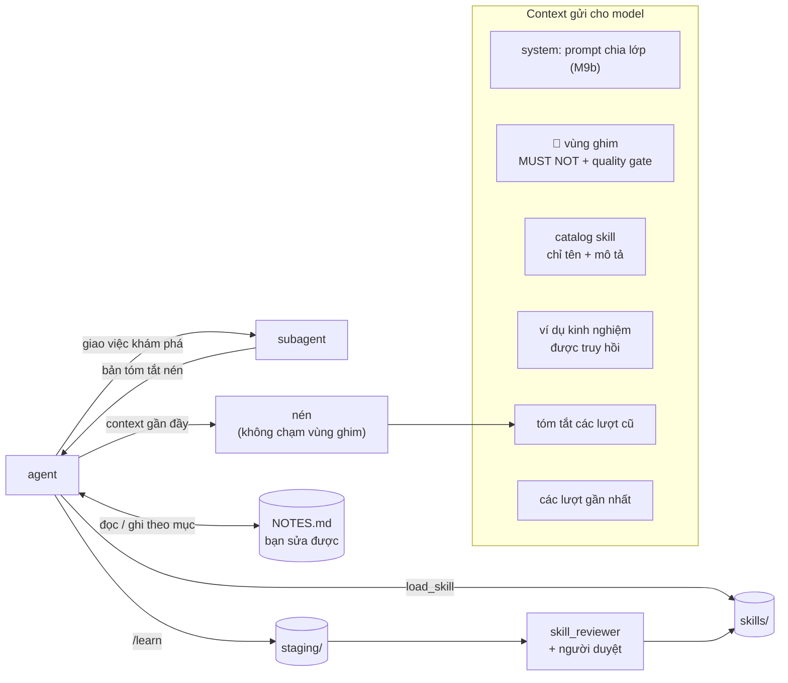

# Act VI — Trí nhớ và kỹ năng

[← Act V](act-5-security-agent.md) · [Plan tổng](../PLAN.md) · [Act VII →](act-7-agent-security.md)

> 📖 *"Task khó cần đọc 30 file: context tràn, agent quên mình đã thử gì. Và mỗi task mới, nó lại học lại từ đầu."*
>
> Sách ch9: system prompt phình từ 500 lên 5.000 token, và agent bỏ qua bước 2 của quy trình deploy 5 bước vì nó
> nằm ở dòng 400. *"The solution is not a larger context window. It is less static."*
> Sách ch22: bộ tóm tắt **âm thầm xóa một dòng "KHÔNG ĐƯỢC LÀM X"**, và agent lập tức làm X.
> Appendix B gọi việc phải dạy lại agent mỗi phiên là "vòng lặp Groundhog Day".

## Mục tiêu của Act

- Context là tài nguyên hữu hạn: nén có kỷ luật, ghim những gì không được mất, scratchpad ngoài context.
- Kiến thức thủ tục nạp khi cần (skill), không nhồi sẵn.
- Kinh nghiệm từ lần thắng được giữ lại; agent tự viết skill nhưng phải qua cổng duyệt.

## Bàn giao cuối Act

Task dài pass được; skill loader có đo định tuyến; `/learn` có staging + review; số liệu "có / không có" cho từng cơ chế.

## Những gì nằm trong context



---

## M17 ★ Quản lý context

- 📖 *"Context đầy thì phải bỏ bớt. Nhưng bỏ cái gì? Sách ch22 cho thấy bỏ nhầm một dòng là thảm họa."*
- 🎯 **Mục tiêu học:** ngân sách token, nén, ghim, scratchpad, subagent.

### 📐 Thiết kế

```python
class ContextBudget:
    limit_tokens: int; compact_at: float = 0.7      # nén khi dùng 70%
class ContextManager:
    pinned: list[str]                  # dòng MUST NOT, quality gate, goal — KHÔNG BAO GIỜ bị nén
    def build(self, history, notes, recent_k: int) -> list[dict]: ...
    def compact(self, old_turns) -> str:  # tóm tắt bằng model rẻ; kiểm sau khi nén: mọi id trong pinned còn nguyên

# NOTES.md (scratchpad) — mục có tên, cập nhật từng mục
## Goal
## Plan
## Tried
## Ruled out
## Next
```

Tool: `update_notes(section, content)`, `read_notes()` (sách ch11). Subagent khám phá: profile chỉ đọc, trả về bản tóm
tắt có cấu trúc (file liên quan, symbol, giả thuyết), không trả cả transcript (ch04 `handoff_with_context.py`).

### 🪜 Các bước

1. Đếm token (dùng `usage` hoặc `count_tokens`), ngưỡng nén.
2. **Vùng ghim**: dựng từ `contract.yaml` và goal; nén xong thì kiểm từng id còn nguyên, thiếu thì bỏ bản nén.
3. Scratchpad theo mục; agent ghi kế hoạch **trước** khi làm việc lớn.
4. **Read-Refine-Repeat**: harness chèn lời nhắc đọc lại `NOTES.md` mỗi K lượt (sách: nếu không, agent chỉ phản ứng
   theo tin nhắn cuối).
5. **Resonance loop**: theo dõi file `NOTES.md`; bạn sửa giữa chừng thì lượt sau agent đọc bản mới. Ghi sự kiện
   `correction` vào trajectory.
6. Crash → tiếp tục từ `NOTES.md` + state file, không làm lại từ đầu.
7. Subagent khám phá cho task cần đọc nhiều file.
8. Thêm vài task **cố ý dài** (cần đọc 20+ file) vào `dev/` và `heldout/`.
9. ○ **Chỉ mục code ngữ nghĩa**: chunk theo hàm/class bằng AST, hybrid ripgrep + vector, RRF (sách ch11).

### 🧪 Kiểm chứng

- **Eval ràng buộc sau nén**: ép nén sớm, rồi đưa một yêu cầu vi phạm MUST NOT; agent vẫn phải từ chối.
- Sửa `NOTES.md` giữa chừng (ví dụ "đừng sửa file X") → agent tuân theo ở lượt sau.

### 📏 Đo

Resolved trên task dài trước và sau; localization khi có / không có subagent (và chỉ mục ngữ nghĩa nếu làm).

### 🔬 Sâu hơn sách

Sách ch11: *"the primary challenge is deciding what deserves to be remembered and what deserves to be forgotten"*.
Vấn đề "tam sao thất bản" của map-reduce (ch13) xuất hiện lại ở đây.

### 🔁 Đối chiếu framework

So với hai thứ làm sẵn: **compaction / context editing phía server** của API (beta, kiểm tra tài liệu) và **checkpoint/state
của LangGraph**. Câu hỏi: vùng ghim và scratchpad tự viết giữ được gì mà tóm tắt tự động làm mất? Đo trên cùng các task dài.

### 📚 Tham khảo

ch04 `online/handoff_with_context.py`; ch11; sách ch11 (scratchpad, RAG engineering), ch22 (memory wall).

### ✅ Xong khi

Task dài pass mà trước đó fail; hai kiểm chứng ở trên xanh.

- [ ] Hoàn thành

---

## M18 ★ Skills với progressive disclosure

- 📖 *"Quy trình chuẩn (viết test, sửa lỗi bảo mật…) không nên nằm thường trực trong prompt. Nạp khi cần."*
- 🎯 **Mục tiêu học:** định dạng skill production; định tuyến skill; đo hiệu quả và khả năng chuyển giao.

### 📐 Thiết kế (theo sách ch9)

```markdown
---
name: pytest-testing
description: Use when asked to write tests, add a regression test, reproduce a bug as a failing test, or fix flaky tests.
allowed-tools: [read_file, edit_file, run_tests]
---
## Clarification Gates
- Which module is under test? Is there an existing tests/ layout? If unclear, STOP and ask.
## Process
1. …
## Rationalizations
| Excuse | Rebuttal |
| "Mock random.randint là được" | Patch tại nơi dùng: module.randint |
| "100% coverage là đủ" | Coverage ≠ feature coverage; dùng --cov-branch và mutation |
| "Test xanh nghĩa là đúng" | Test phải đỏ trên code lỗi trước đã |
## Verification
- [ ] Test mới đỏ trên code cũ, xanh sau khi sửa
```

```python
def discover(roots: list[Path]) -> list[SkillMeta]: ...    # chỉ đọc frontmatter
def catalog_block(skills) -> str: ...                       # <available_skills>…</available_skills>
class LoadSkill(Tool):                                      # trả body; path phải nằm trong roots (Model proposes, code disposes)
```

### 🪜 Các bước

1. Loader + tool `load_skill` (đường dẫn kiểm như M5; sách ch9 có code mẫu `skill_loader.py` mà repo thiếu, task t005).
2. Skill đầu tiên: `pytest-testing`, chưng cất từ `OtherConcepts/tong-hop-modern-python-testing.md`.
3. Luật script đi kèm skill (ch9): không hỏi tương tác, xuất JSON, exit code riêng cho từng loại lỗi, ghim phiên bản.
4. Mô tả viết như câu tìm kiếm; mỗi skill dưới khoảng 500 token; **mặc định thay vì menu**; việc dễ hỏng thì ghi lệnh
   chính xác.
5. Thêm 10–20 skill "gây nhiễu" có mô tả gần giống để đo định tuyến.

### 📏 Đo

- Resolved và chất lượng test tái hiện (M13b) khi có / không có `pytest-testing`.
- **Độ chính xác định tuyến**: skill đúng được nạp không, khi có nhiễu. Sách dẫn khảo sát 2026: quá 50 skill thì chọn
  nhầm skill thành nguồn lỗi chính.
- **Chuyển giao** (theo SkillOpt trong sách): skill viết với Haiku có giúp Sonnet không; skill dùng trong Prova có
  giúp Claude Code không (đặt vào `.claude/skills/` và chạy M12b).

### 📚 Tham khảo

ch09 `skills/`, `README.md`; ch03 `online/skill_auto_discovery.py`; `shared/declarative_skills/`; sách ch9, phụ lục SkillOpt.

### ✅ Xong khi

Ba nhóm số liệu ở trên có trong `LEARNINGS.md`.

- [ ] Hoàn thành

---

## M19 ○ Thư viện kinh nghiệm

- 📖 *"Lần thứ chín mới giải được một task khó. Hệ thống tĩnh vứt bỏ phiên đó; số token bỏ ra chỉ mua được một PR."*
- 🎯 **Mục tiêu học:** chưng cất kinh nghiệm; truy hồi; kiểm soát nguồn học.

### 🪜 Các bước

1. Khi task thắng sau ≥ 2 lần thử: chưng cất thành ví dụ mẫu (loại task, quyết định then chốt, cạm bẫy), **không**
   chứa dữ liệu phiên (sách ch20, Appendix B).
2. Lưu vào vector store local; truy hồi theo issue mới; ○ độ nổi bật giảm dần (ch11 `memory_decay.py`).
3. **Kiểm soát nguồn học** (AReaL2.0 trong sách): trajectory từ repo không tin cậy hoặc có cảnh báo injection (M21)
   không được chưng cất tự động; cần người duyệt.

### 📏 Đo

Số lần thử trung bình trên task "anh em" (cùng loại bug) khi có / không có thư viện. Dùng split để không rò rỉ đáp án
từ `heldout/`.

### 📚 Tham khảo

ch20 `online/experience_distiller.py`; ch11 `memory_agent.py`, `online/memory_decay.py`; sách ch11, ch20, phụ lục AReaL2.0.

- [ ] Hoàn thành

---

## M20 ★ `/learn` có cổng duyệt

- 📖 *"Agent tự viết skill cho chính nó: đó là code thực thi, phải được review như code. Sách kể skill bị 'hóa thạch'
  số doanh thu tháng 9, về sau lần nào cũng tự tin báo cáo một quý đã qua."*
- 🎯 **Mục tiêu học:** để hệ thống học mà không tự đầu độc mình.

### 🪜 Các bước

1. `/learn` đọc trajectory thắng (chỉ `outcome = success`), sinh `SKILL.md` vào `staging/`.
2. **Chưng cất quy trình, không chưng cất dữ liệu**: prompt yêu cầu loại bỏ số liệu, ngày, tên, nội dung file.
3. `skill_reviewer` tĩnh (ch21): dữ liệu phiên, cài package không ghim phiên bản, `curl | sh`, tool vượt phạm vi,
   comment HTML ẩn.
4. Người duyệt mới chuyển sang `skills/`. Thay đổi skill đi qua PR như code.
5. **Bài học nhỏ** (một quy ước, một "đừng làm X"): thêm một dòng vào `AGENTS.md`, cũng qua review (Appendix B).
6. **Sửa skill có kỷ luật** (SkillOpt): mỗi lần chỉ sửa tối đa vài chỗ ("learning rate bằng chữ"); log các đề xuất bị
   loại; **vùng "bài học bền vững" được bảo vệ** mà lần sửa thường không ghi đè.

### 🧪 Kiểm chứng

Skill chứa dữ liệu phiên hoặc `pip install` không ghim phiên bản bị chặn ở staging.

### 📚 Tham khảo

ch21 `learn_command.py`, `online/skill_reviewer.py`; ch09 `skills/skill-security-audit`; sách ch9, ch21, Appendix B,
phụ lục SkillOpt.

### ✅ Xong khi

Kiểm chứng xanh; một skill thật đi trọn vòng staging → review → skills/.

- [ ] Hoàn thành

---

## Cuối Act VI

- [ ] Review bằng [checklist anti-pattern](shared/anti-patterns.md).
- [ ] `LEARNINGS.md`: cơ chế nào thật sự giúp, cơ chế nào không.

[Act VII: Tự vệ →](act-7-agent-security.md)
