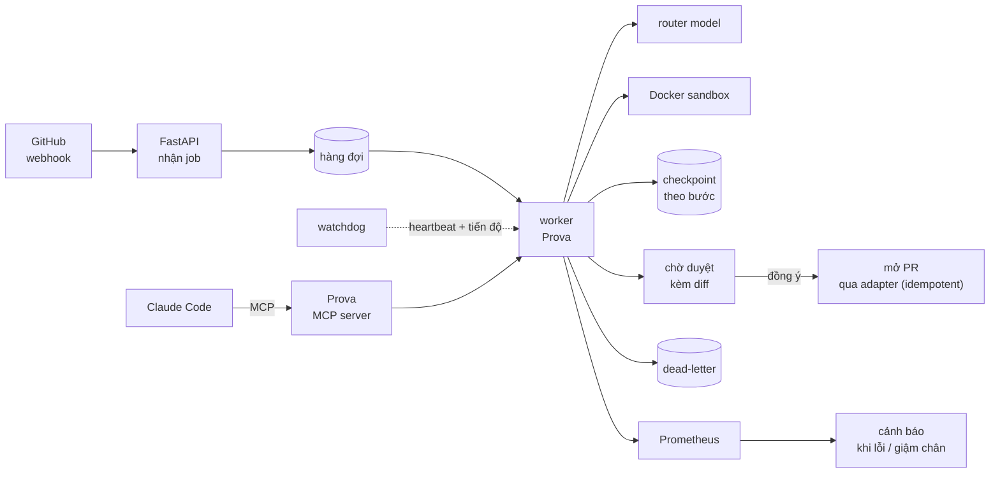

# Act VIII — Vận hành

[← Act VII](act-7-agent-security.md) · [Plan tổng](../PLAN.md) · [Act IX →](act-9-self-improve.md)

> 📖 *"Prova chạy tốt trên máy bạn. Giờ cho nó chạy thật, liên tục, và tự báo khi hỏng."*
>
> Sách ch16: agent chạy qua đêm để xử lý 200 việc, chết lúc 2:47 sáng ở việc thứ 12 vì một JSON hỏng từ API bên
> thứ ba; 188 việc còn lại nằm im. *"We had deployed an agent. We had not deployed a service."*
> Sách ch19: *"an agent fails actively, creatively, and expensively"*, và hai thứ bắt buộc trước khi chạy thật là
> **ngân sách chi phí** và **tool idempotent**.

## Mục tiêu của Act

- Chi phí thấp hơn mà chất lượng không giảm.
- Service bất đồng bộ có metric riêng cho agent.
- Worker chạy liên tục, an toàn khi crash, không trùng lặp, tự báo khi hỏng, có người duyệt.
- Review PR tự động; Prova dùng được từ Claude Code qua MCP.

## Bàn giao cuối Act

`docker compose up` dựng API + worker + hàng đợi + metric; review PR tự động trên một repo thử nghiệm; MCP server.

## Triển khai

---

## M23 ★ Định tuyến model và chi phí

- 📖 *"Một provider sập đúng giờ cao điểm (sách ch7). Và không có lý do gì để gửi việc parse log cho Opus với giá
  gấp mười lần."*
- 🎯 **Mục tiêu học:** caching, fallback, router học từ dữ liệu, "model rẻ nhất mà vẫn làm đúng".

### 🪜 Các bước

1. **Prompt caching**: đánh dấu `cache_control` ở phần system tĩnh và định nghĩa tool (đã đặt tĩnh trước, động sau ở
   M9b). Đọc `cache_creation_input_tokens` / `cache_read_input_tokens` trong `usage` để đo tỉ lệ hit. Kiểm tra tài liệu
   hiện tại cho giới hạn và thời gian sống của cache.
2. **Một định nghĩa tool, nhiều phong bì** (sách ch3): adapter sinh định dạng cho từng provider từ cùng `args_model`.
3. **Circuit breaker** cho provider (ch07 `model_router.py`): lỗi liên tiếp thì tạm bỏ qua trong một khoảng thời gian.
4. **Router học** (ch20 `learned_router.py`): tỉ lệ thành công theo (loại bước × model), có `MIN_SAMPLES` và tỉ lệ
   khám phá. Loại bước: khám phá, viết test, sửa, tóm tắt, review.
5. ○ Ollama cho phát triển offline; dùng kết quả M16 để biết model nhỏ vỡ ở đâu.

### 📏 Đo

Chi phí / task và resolved trên heldout: trước và sau từng bước; tỉ lệ cache hit.

### 📚 Tham khảo

ch07 `online/model_router.py`, `online/ollama_tool_calling.py`; ch20 `online/learned_router.py`; sách ch3, ch7, ch13, ch20.

### ✅ Xong khi

Chi phí giảm đo được, resolved không tụt quá 1 SEM.

- [ ] Hoàn thành

---

## M24 ★ Service + metric

- 📖 *"Metric của web app (latency, error rate) không cho biết agent có làm tốt không."*
- 🎯 **Mục tiêu học:** service bất đồng bộ; metric riêng cho agent.

### 🪜 Các bước

1. FastAPI: `POST /jobs` (trả `job_id`), `GET /jobs/{id}`, stream sự kiện qua SSE.
2. Hàng đợi (Redis hoặc tương đương) + worker; Docker Compose cho API, worker, hàng đợi, Prometheus.
3. Metric (ch19 `agent_monitoring_dashboard.py`): job theo trạng thái, tool call / job, chi phí / job, vượt ngân sách,
   số lần escalate, số lần circuit breaker ngắt, tỉ lệ resolved khi có nhãn.
4. ○ Giao diện tiến độ (sách ch21): thẻ Plan ✔ → Code → Test ⏳ → Review ⏳ → Duyệt ⏳.
5. ○ LiteLLM proxy giữ key tập trung (ch19).

### 📚 Tham khảo

ch19 `api.py`, `online/agent_monitoring_dashboard.py`, `docker-compose.yml`, `online/litellm_proxy_server.py`; sách ch19, ch21.

### ✅ Xong khi

`docker compose up` rồi gửi một job, xem được tiến độ và metric.

- [ ] Hoàn thành

---

## M25 ★ Worker chạy liên tục

- 📖 *"Một script chết thì thôi; một service thì tự dựng lại. Và sách ch16: trường hợp khó nhất là agent vẫn sống,
  heartbeat vẫn chạy, nhưng giậm chân tại chỗ và vẫn tính tiền."*
- 🎯 **Mục tiêu học:** độ bền khi chạy dài: idempotent, checkpoint, watchdog theo tiến độ, kill-switch, người duyệt.

### 🧱 Hai thứ bắt buộc trước khi chạy thật (sách ch19)

1. **Ngân sách chi phí** theo task, theo phiên, theo ngày; vượt thì dừng hẳn và cảnh báo.
2. **Tool có tác dụng phụ phải idempotent**: kiểm branch, PR, comment đã tồn tại chưa trước khi tạo. Khóa idempotency
   = (repo, issue hoặc PR, commit SHA, loại hành động).

### 🪜 Các bước

1. Nhận webhook GitHub; **kiểm chữ ký** webhook; khi khởi động, **xả backlog** (sự kiện bị lỡ lúc worker tắt, ch16).
2. **Checkpoint theo bước** (sau grill, sau mỗi vòng sửa, sau review): crash thì tiếp tục từ checkpoint.
3. **Heartbeat cả trong lúc task dài** (sửa lỗi t010 của ch16).
4. **Watchdog theo dõi tiến độ, không chỉ sự sống**: task xong mỗi giờ, token đốt mà không có tiến bộ (fingerprint
   không đổi), thời gian ở một bước. Backoff mũ khi restart; quá `MAX_RESTARTS` thì cảnh báo.
5. **Timeout tường minh** cho mọi client (API, GitHub, sandbox); theo dõi bộ nhớ khi chạy nhiều giờ.
6. **Dead-letter queue**: job lỗi đi vào đây kèm lý do, không retry vô hạn.
7. **Người duyệt** qua interrupt/resume **kèm diff**: không mở PR nào mà không có người duyệt (sách ch21), trừ khi khớp
   chính sách ủy quyền trước (M16).
8. **Adapter GitHub / GitLab** theo dependency injection (sửa kiểu copy-paste cả đồ thị của ch22).
9. **Kill-switch thật**: một lệnh / một cờ dừng mọi worker và chặn job mới; **có test** (sách ch22 cảnh báo kill-switch
   "chỉ để làm cảnh").
10. **Thất bại phải ồn ào**: token hết hạn, API lỗi → cảnh báo, không in "0 issue" (anti-pattern #10).

### 🧪 Kiểm chứng

| Kịch bản | Kỳ vọng |
|---|---|
| kill worker giữa task | restart, tiếp tục từ checkpoint, không tạo PR trùng |
| cùng webhook gửi hai lần | chỉ một job, một PR |
| agent giậm chân 20 phút | watchdog phát hiện qua tiến độ, escalate |
| token GitHub hết hạn | cảnh báo rõ ràng |
| bấm kill-switch | mọi worker dừng trong X giây, job mới bị từ chối |

### 🩹 Sửa lỗi của sách

Heartbeat chỉ giữa các task; spam comment mỗi đêm (t011); "0 issue" khi token hết hạn; người duyệt chỉ thấy tên file;
adapter copy-paste cả đồ thị; `git push` thiếu trước `gh pr create`.

### 📚 Tham khảo

ch16 (cả 4 file); ch05 `online/approval_gateway.py`; ch22 `atlas_capstone.py`, `online/atlas_gitlab_adapter.py`,
`online/atlas_nightly_runner.py`; sách ch16, ch19, ch21, ch22.

### ✅ Xong khi

Mọi dòng trong bảng kiểm chứng đúng kỳ vọng.

- [ ] Hoàn thành

---

## M25c ★ Sync và watch chạy liên tục

- 📖 *"Lịch cron ở Act V chạy được, nhưng khi nó hỏng lúc 3 giờ sáng thì không ai biết. Và lỗ hổng mới không chờ ai."*
- 🎯 **Mục tiêu học:** đưa sync (S1) và watch (S6b) thành dịch vụ có độ bền như phần còn lại của Act này.

### 🪜 Các bước

1. Worker chạy `kb sync` theo lịch riêng cho từng loại nguồn (bảng ở S1); job sync là idempotent và có checkpoint.
2. Sau mỗi lần sync luồng nhanh, phát sự kiện `advisories_updated` → job watch (S6b) cho từng repo đăng ký.
3. Retry có backoff khi nguồn lỗi tạm thời; tôn trọng rate limit (NVD); lỗi kéo dài thì cảnh báo.
4. Metric Prometheus: **tuổi dữ liệu** từng nguồn, số advisory mới mỗi lần, số cảnh báo theo mức ưu tiên, **độ trễ phát hiện**
   (công bố → cảnh báo), số lần sync bị cổng eval chặn.
5. Cảnh báo khi: một nguồn "đứng" quá ngưỡng tuổi, sync bị chặn liên tục, hoặc có cảnh báo `urgent` (KEV).
6. Kill-switch của M25 áp dụng cả cho job sync và watch.

### 🧪 Kiểm chứng

| Kịch bản | Kỳ vọng |
|---|---|
| Nguồn OSV lỗi 6 giờ | cảnh báo "nguồn đứng"; các nguồn khác vẫn chạy |
| Worker bị kill giữa lần sync | lần sau tiếp tục, không embed trùng, không cảnh báo trùng |
| Advisory có trong KEV ảnh hưởng repo đăng ký | cảnh báo `urgent` trong vòng một chu kỳ sync |

### 📚 Tham khảo

[Act V S1, S6b](act-5-security-agent.md); M25 trong Act này; ch16 (scheduled, event-driven); ch19 (idempotent, durable execution).

### ✅ Xong khi

Một tuần chạy tự động, có metric tuổi dữ liệu và độ trễ phát hiện; ba kịch bản kiểm chứng đúng kỳ vọng.

- [ ] Hoàn thành

---

## M25b ★ Review PR tự động trên GitHub

- 📖 *"Reviewer chạy tốt trên máy. Giờ để nó tự comment mỗi khi có PR mới, mà không thành lỗ hổng."*

### 🪜 Các bước

1. Webhook hoặc GitHub Action khi có sự kiện `pull_request`; chạy chế độ review (M14b) **và review bảo mật
   (Act V S3–S4)**: chỉ đăng finding bảo mật đã có PoC, hoặc gắn nhãn rõ "chưa chứng minh".
2. Token **chỉ có quyền đọc và comment**.
3. Mô tả PR và diff là **dữ liệu không tin cậy** (M21): người ngoài có thể mở PR chứa lệnh giấu.
4. Lỗi thì đăng **"không review được"** kèm lý do, không im lặng, không bao giờ "approved" (fail-closed).
5. **Idempotent**: cùng commit SHA không review hai lần; cập nhật comment cũ thay vì đăng mới.

### 🧪 Kiểm chứng

Mở PR có bug trên repo thử nghiệm → comment đúng chỗ; đẩy lại cùng commit → không comment trùng; PR có lệnh giấu →
không làm theo.

### 📚 Tham khảo

ch10 `online/claude_code_ci.py`; ch22 `online/atlas_nightly_runner.py` (ví dụ ngược); ch14.

- [ ] Hoàn thành

---

## M26 ★ Prova là MCP server

- 📖 *"Prova đã tốt. Giờ cho nó dùng được ngay trong công cụ bạn dùng hằng ngày, thay vì phải mở một terminal riêng."*

### 🪜 Các bước

1. MCP server (stdio, ○ HTTP) đưa ra `review_pr`, `run_benchmark_task`, `search_trajectories`. **Log ra stderr**, không
   in gì ra stdout (bài học t004).
2. Kết nối từ Claude Code; dùng thật trên repo của bạn một tuần, ghi nhận xét vào `LEARNINGS.md`.
3. Adapter GitHub ở M25 dùng GitHub MCP server, thực hiện đúng lời hứa *"MCP for GitHub access"* mà docstring capstone
   đưa ra nhưng code không làm.
4. Credentials của bot nằm trong vault hoặc secret store, không trong code hay log (ý tưởng vault của Managed Agents, sách ch21).
5. ○ So sánh với MCP connector của Anthropic API (kiểm tra tài liệu hiện tại).
6. ○ Reviewer từ xa qua A2A, **fail-closed** (sửa t009).

### 📚 Tham khảo

ch08; ch22 `atlas_capstone.py` (docstring), `online/atlas_with_a2a_security.py`; sách ch8, ch10, ch21.

### ✅ Xong khi

Từ Claude Code gọi được `review_pr` trên một PR thật và nhận về findings có cấu trúc.

- [ ] Hoàn thành

---

## Cuối Act VIII

- [ ] Review bằng [checklist anti-pattern](shared/anti-patterns.md), đặc biệt #8, #10.
- [ ] Chạy một tuần liên tục trên repo thử nghiệm; ghi sự cố vào `escalations.md`.

[Act IX: Tự cải thiện và công bố →](act-9-self-improve.md)
