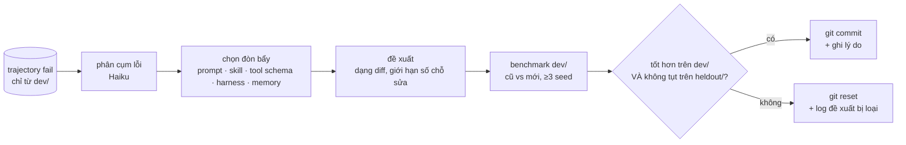

# Act IX — Tự cải thiện và công bố

[← Act VIII](act-8-operations.md) · [Plan tổng](../PLAN.md)

> 📖 *"Có dữ liệu rồi. Giờ để hệ thống tự đề xuất cải tiến, nhưng chỉ giữ những gì benchmark chứng minh là tốt hơn."*
>
> Sách ch22: một pilot tự cải thiện tăng hiệu suất hai chữ số trong vài tuần, rồi bị tắt vì không ai giải thích được
> cho hội đồng rủi ro vì sao hệ thống thay đổi hành vi. Nó đã tự bỏ một bước phê duyệt.
> Kết luận phụ lục: *"an evaluator you trust more than the thing being evolved. The search algorithm is not the hard
> part. The evaluator is."*

## Mục tiêu của Act

- Vòng tự cải thiện **có cổng**, giải thích được, không tự sửa bộ đo của mình.
- Thử tiến hóa code trên một bài nhỏ có đáp án.
- Công bố kết quả trung thực.

## Bàn giao cuối Act

Vòng ratchet chạy được và để lại lịch sử diff + số liệu; bài viết, README, video, CV.

## Vòng tự cải thiện có cổng



---

## M27 ★ Tối ưu có cổng eval

- 📖 *"Mình đã tự tay chỉnh prompt hàng chục lần. Sách ch9 kể bốn ngày chỉnh tay chỉ tăng 1,2% độ chính xác mà độ
  trễ tăng 350ms. Để máy làm, nhưng phải có kỷ luật."*
- 🎯 **Mục tiêu học:** thiết kế vòng tối ưu theo sách và các bài báo; năm điều kiện tiên quyết.

### 🛡️ Năm điều kiện tiên quyết (sách ch22), kiểm trước khi bắt đầu

- [ ] Vòng phản hồi gắn với kết quả thật (resolved trên benchmark, không phải điểm judge).
- [ ] Guardrail viết thành logic tất định (Act II, VI).
- [ ] Quan sát được hành vi: mỗi thay đổi là một commit có lý do và số liệu.
- [ ] Người can thiệp được thật (duyệt hoặc revert).
- [ ] Kill-switch thật (M25).

### 📐 Thiết kế

```yaml
# scaffold.yaml — FILE DUY NHẤT optimizer được phép sửa (ratchet kiểu Karpathy)
prompt_layers: {instructions: "prompts/20-instructions.md", tool_policy: "prompts/30-tool-policy.md"}
loop: {max_attempts: 6, stall_limit: 2, feedback_lines: 8}
context: {compact_at: 0.7, recent_k: 6}
routing: {explore: cheap, fix: strong, summarize: cheap}
```

```python
class Proposal(BaseModel):
    cluster_id: str
    lever: Literal["prompt", "skill", "tool_schema", "harness_code", "memory", "rollback"]
    rationale: str                 # bằng chứng từ trajectory
    diff: str                      # chỉ sửa scaffold.yaml hoặc file nó trỏ tới; tối đa N hunk
```

### 🪜 Các bước

1. **Phân cụm lỗi** từ trajectory fail của `dev/` (Haiku), dùng metric chẩn đoán (localization, error_recovery…).
2. **Chọn đòn bẩy** (AReaL2.0 trong sách): với mỗi cụm, ghi rõ sửa ở đâu và vì sao. Đừng mặc định "sửa system prompt".
3. **Phản tư bằng ngôn ngữ** (GEPA): model đọc vài trajectory fail cụ thể, chẩn đoán, đề xuất.
4. **Giới hạn số chỗ sửa mỗi lần**, đề xuất dạng diff (SkillOpt, AlphaEvolve); **log đề xuất bị loại** để không đề xuất lại.
5. **Ratchet** (Karpathy AutoResearch): chạy `dev/` ≥ 3 seed; tốt hơn thì `git commit` kèm lý do, không thì `git reset`.
6. **Chọn ứng viên kiểu Pareto** (GEPA): giữ cấu hình nếu nó tốt nhất ở ít nhất một task, để không hội tụ quá sớm.
7. **Cổng held-out**: định kỳ chạy `heldout/`; tụt thì revert về commit tốt gần nhất.
8. **Optimizer không được ghi vào `bench/`** (bảo vệ bộ eval, spec mục 10).
9. ○ **Tự tổng hợp tool** (ch20): khi agent lặp lại cùng một chuỗi suy luận tất định, đề xuất một hàm Python, test trong
   sandbox, người duyệt rồi mới đăng ký.

### 📏 Đo

Đường resolved trên `dev/` và `heldout/` theo số vòng ratchet; chi phí của chính vòng tối ưu; số đề xuất được giữ / bị loại
theo từng loại đòn bẩy.

### ⚠️ Bẫy thường gặp

- Overfit vào `dev/` nhỏ (sách ch9). Dấu hiệu: `dev/` tăng, `heldout/` đứng yên hoặc giảm.
- Evaluator có kẽ hở thì bị khai thác (phụ lục). Kiểm gian lận như spec mục 6.
- "Ít khi bắt lỗi" ≠ "vô dụng": đừng để optimizer bỏ reviewer chỉ vì nó hiếm khi chặn (bài học scaffold_optimizer ch23).

### 🩹 Sửa lỗi của sách

Cổng eval một lần chạy (prompt_critic, ch20); `scaffold_optimizer.py` (ch23) không áp dụng và không kiểm tra thay đổi;
bẫy Goodhart (chỉ tối ưu chi phí).

### 🔁 Đối chiếu framework

So optimizer tự viết với **DSPy (GEPA)** trên cùng bộ dev/heldout và cùng ngân sách: ai tăng heldout nhiều hơn, ai overfit dev.

### 📚 Tham khảo

ch20 `online/prompt_critic.py`; ch02 `prompt_ab_test.py`; ch23 `online/scaffold_optimizer.py`; sách ch20 (harness that
learns), ch22 (DGM, Hyperagents, Karpathy loop, 5 điều kiện), phụ lục (GEPA, SkillOpt, AlphaEvolve, AReaL2.0).
Sách nhắc: số liệu trong các bài báo là *"do tác giả báo cáo"*.

### ✅ Xong khi

Ít nhất một cải tiến được giữ có số liệu trên `heldout/`, và lịch sử ratchet giải thích được từng thay đổi.

- [ ] Hoàn thành

---

## M27b ○ Tiến hóa code bằng OpenEvolve

- 📖 *"Phụ lục nói chỉ có một công cụ 'cài trước bữa trưa' được: OpenEvolve. Thử nó, nhưng bắt đầu từ bài đã biết đáp án."*

### 🪜 Các bước

1. Chạy ví dụ của sách: tiến hóa bubble sort; evaluator **kiểm đúng sai trước**, tốc độ sau.
2. Chọn một heuristic của harness có tiêu chí kiểm bằng máy, ví dụ `failure_fingerprint` (M13), chấm trên tập trajectory
   đã gắn nhãn "có tiến bộ / giậm chân"; tách tập kiểm tra riêng.
3. So bản tiến hóa với bản viết tay trên tập kiểm tra.

### ⚠️ Bẫy

*"A bad evaluator gets exploited, not fooled: một nghìn ứng viên qua một nghìn vòng sẽ tìm ra kẽ hở."* Thiết kế evaluator
có kiểm gian lận; chạy trong sandbox.

### 📚 Tham khảo

Sách ch9 (auto-optimization, fitness đa mục tiêu, MAP-Elites), phụ lục C.3–C.4. Kiểm tra API hiện tại của OpenEvolve trước khi dùng.

- [ ] Hoàn thành

---

## M28 ○ So với harness và framework của nền tảng

- 📖 *"Sách ch17: mọi thứ mình tự viết (sandbox, state, audit, restart) chính là thứ Managed Agents cung cấp. Giờ đã đủ
  hiểu để đánh giá trade-off."*

### 🪜 Các bước

1. **Claude Agent SDK** (Claude Code dạng thư viện): port lõi của Prova sang, giữ tool, hooks và verifier của mình.
   So số dòng code, điểm benchmark (≥ 3 seed), chi phí, và **những gì mất quyền kiểm soát**.
2. **Managed Agents** (beta; kiểm tra tài liệu hiện tại): chạy cùng benchmark; thử "outcome rubric" (`define_outcome`)
   như một verifier thay thế.
3. Tổng hợp thành bảng **"khi nào nên dùng framework, khi nào nên tự viết"** cùng các mục 🔁 Đối chiếu framework của
   M3, M4, S2, M17, M27; đưa vào README ở M29.

### 📚 Tham khảo

ch17 `managed_agents.py`, `online/claude_managed_agent.py`; sách ch17, ch21 (Option E).

- [ ] Hoàn thành

---

## M29 ★ Viết lại hành trình

- 📖 *"Sách: 'show the evaluator, show the numbers, or say plainly that you haven't yet.'"*

### 🪜 Các bước

1. **README**: kiến trúc, cách chạy, bảng kết quả (fix-bench, review-bench, security-bench) có SEM, so với Claude Code.
2. **Tài liệu trung thực** (sách ch10): CI chạy mọi ví dụ trong README; fail thì sửa tài liệu cho khớp hành vi thật.
3. **Bài blog** "điều gì thật sự giúp coding agent tốt hơn": dữ liệu từ M13, M13b, M14, M16, M17, M18, M27; kể cả những
   thứ **không** giúp. So sánh cách đo: eval từ khóa của capstone trong sách với test ẩn có kiểm chéo.
4. **Video demo** 1–2 phút: issue → grill → tái hiện → sửa → review → PR chờ duyệt.
5. **CV**: chỉ dùng số đã đo, ghi rõ kích thước benchmark và số seed.

### ✅ Xong khi

Một người lạ clone repo, làm theo README, chạy được benchmark và ra số gần với số bạn công bố.

- [ ] Hoàn thành

---

## Cuối plan

- [ ] Review toàn bộ bằng [checklist anti-pattern](shared/anti-patterns.md).
- [ ] Cân nhắc **Project 2: Pentest agent** (xem [plan tổng](../PLAN.md#sau-plan-project-2--pentest-agent)).
